<p align="center">
  
</p>

<h1 align="center">CaptureME</h1>

<p align="center">
  <b>แอปจับภาพหน้าจอฟรีสำหรับ Mac</b> · <i>Free screenshot &amp; annotation app for Mac</i><br>
  จับภาพ · เขียนกำกับ · OCR ไทย/อังกฤษ · สกรอลล์จับภาพ · บันทึกหน้าจอ
</p>

<p align="center">
  <a href="LICENSE"></a>
  <a href="PRIVACY.md"></a>
  
  
  
  
</p>

<p align="center">
  <a href="https://github.com/POBIM/captureme/releases/latest"></a>
</p>

<p align="center">
  <b><a href="https://github.com/POBIM/captureme/releases/latest">⬇️ ดาวน์โหลด CaptureME สำหรับ Mac (ฟรี) → github.com/POBIM/captureme/releases/latest</a></b><br>
  <sub>ไฟล์ <code>CaptureME_…_universal.dmg</code> · macOS 14+ · Apple Silicon และ Intel · ~8 MB</sub>
</p>

<p align="center">
  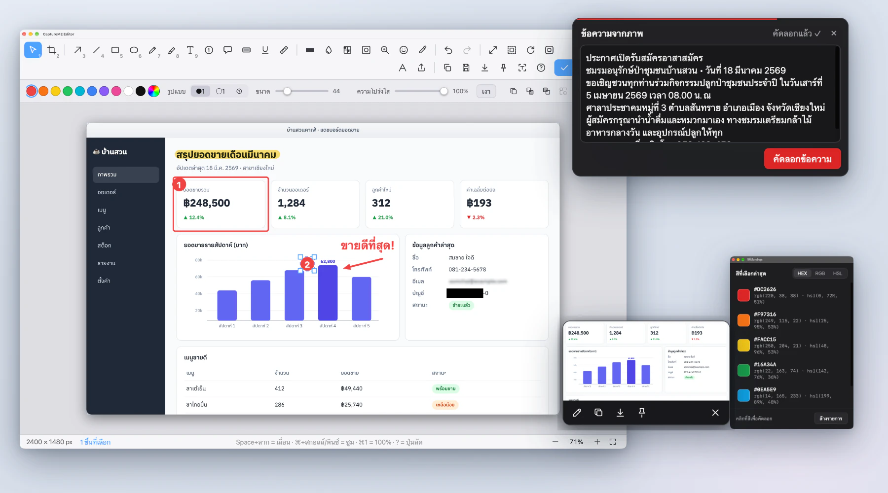<br>
  <sub>ภาพนี้คือ <b>หน้าต่างจริงของแอป</b> ถ่ายบนหน้าจอโล่ง ๆ (เนื้อหาตัวอย่างเขียนขึ้นเอง) · <i>Real app windows on an empty desktop – sample content is made up.</i></sub>
</p>

[ภาษาไทย](#ภาษาไทย) · [English](#english) · [คู่มือติดตั้ง](docs/INSTALL-TH.md) · [คู่มือใช้งาน](docs/USER-GUIDE-TH.md) · [Install guide](docs/INSTALL-EN.md) · [User guide](docs/USER-GUIDE-EN.md) · [Privacy](PRIVACY.md)

## 🚀 เริ่มใน 3 ขั้นตอน
| ① ดาวน์โหลดจาก GitHub | ② ลาก CaptureME ไป Applications | ③ เปิด · อนุญาต Screen Recording · จับภาพ |
|:--:|:--:|:--:|
| <a href="docs/INSTALL-TH.md#ขั้นตอนที่-1--ดาวน์โหลดจาก-github">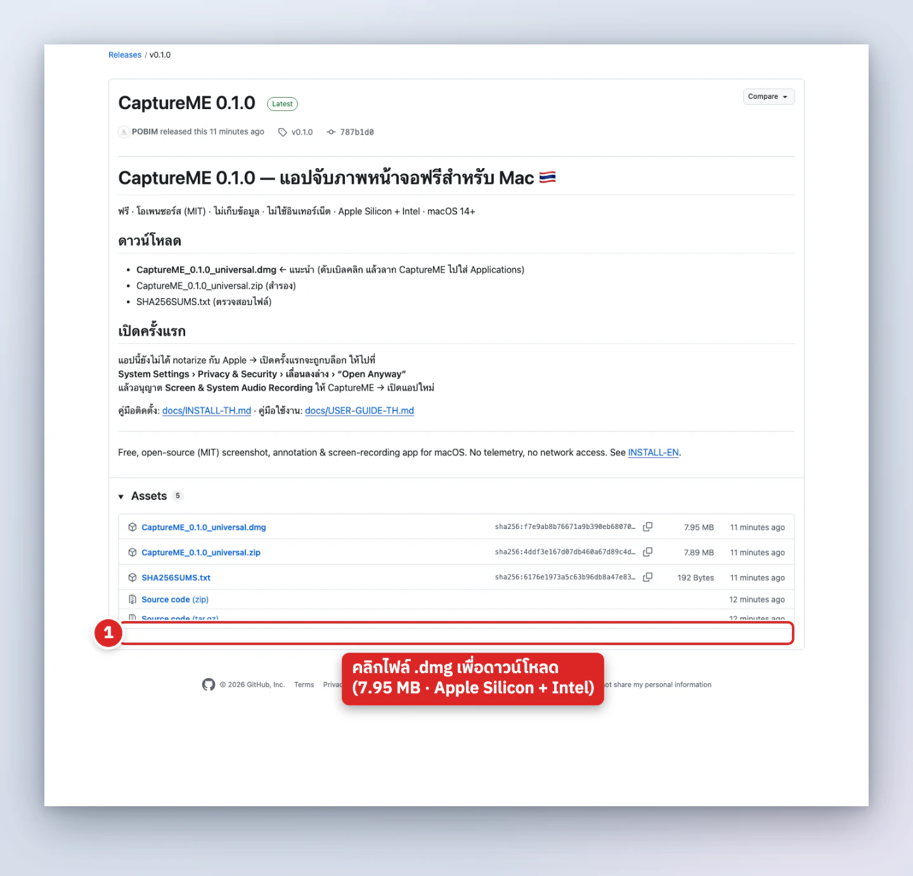</a> | <a href="docs/INSTALL-TH.md#ขั้นตอนที่-2--ลากลงใน-applications">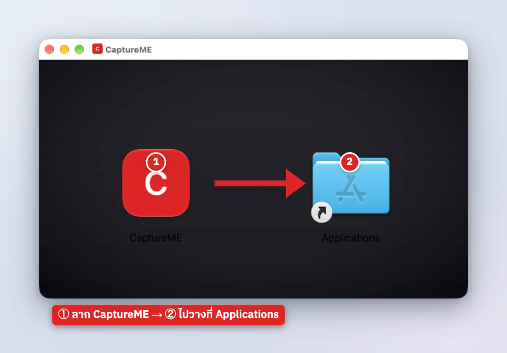</a> | <a href="docs/INSTALL-TH.md#ขั้นตอนที่-4--อนุญาต-screen-recording">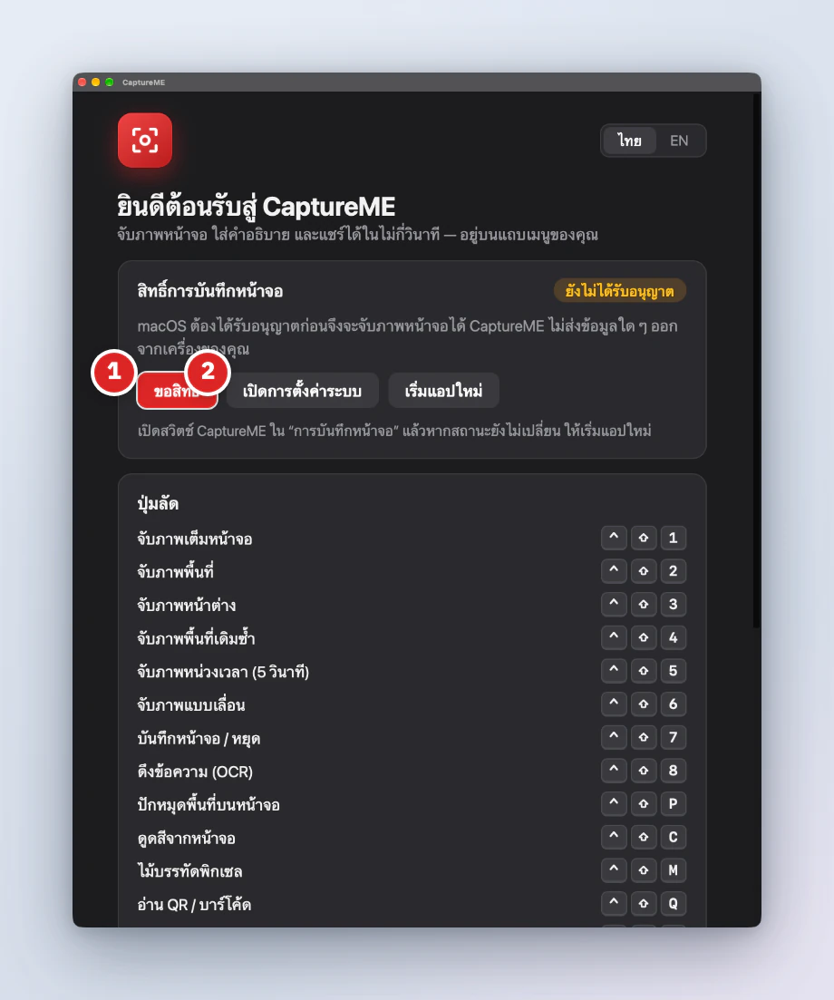</a> |
| กดไฟล์ <code>.dmg</code> ในหัวข้อ **Assets** | ดับเบิลคลิก DMG แล้วลากไอคอนไปวาง | กด `⌃⇧2` ลากเลือกพื้นที่ → ภาพเปิดในตัวแก้ไข |

macOS จะเตือนครั้งแรกเพราะแอปไม่ได้ลงนามกับ Apple (ฟรี ไม่ใช่ไวรัส) → ทำตาม **[คู่มือติดตั้งพร้อมภาพจริง](docs/INSTALL-TH.md)** ครั้งเดียวก็เสร็จ

## 🖼️ ดูว่ามีอะไรบ้าง (คลิกภาพเพื่ออ่านวิธีใช้)
| | | |
|:--:|:--:|:--:|
| <a href="docs/USER-GUIDE-TH.md#2-จับภาพ">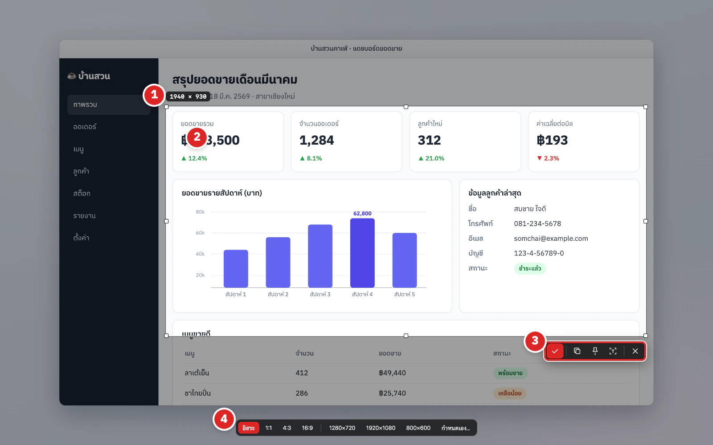</a><br><sub><b>จับภาพ</b> พื้นที่ · หน้าต่าง · เต็มจอ</sub> | <a href="docs/USER-GUIDE-TH.md#3-ตัวแก้ไขภาพ--ทีละเครื่องมือ">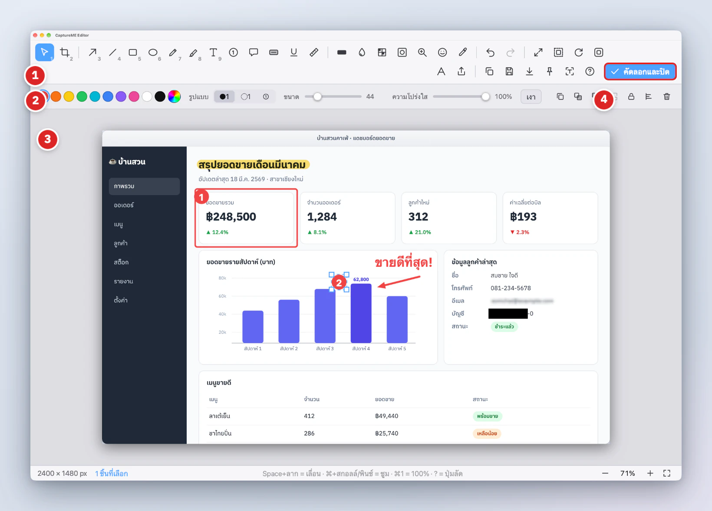</a><br><sub><b>ตัวแก้ไข</b> 20+ เครื่องมือ</sub> | <a href="docs/USER-GUIDE-TH.md#37-ปิดทึบ--เบลอ--โมเสก--d-b-x">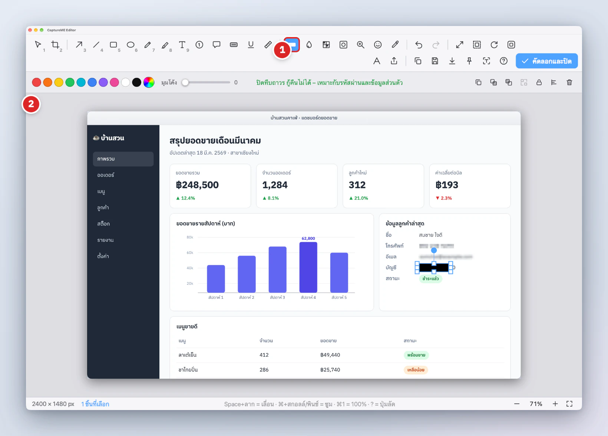</a><br><sub><b>ปิดทึบ · เบลอ · โมเสก</b></sub> |
| <a href="docs/USER-GUIDE-TH.md#312-พื้นหลังตกแต่ง-beautifier">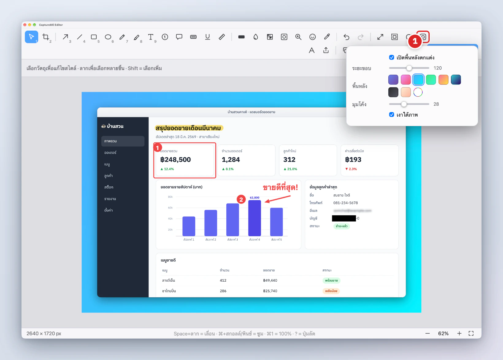</a><br><sub><b>พื้นหลังตกแต่ง</b></sub> | <a href="docs/USER-GUIDE-TH.md#5-ocr--อ่านข้อความจากภาพ">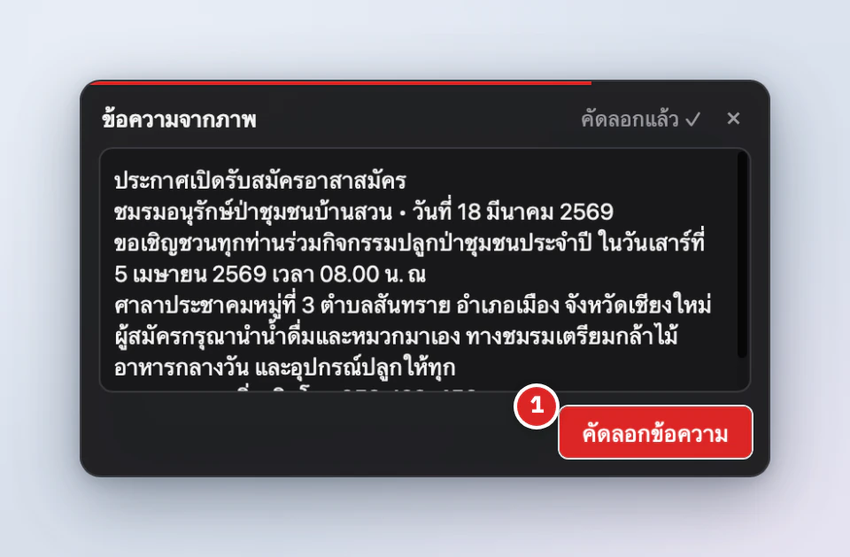</a><br><sub><b>OCR</b> ไทย + อังกฤษ</sub> | <a href="docs/USER-GUIDE-TH.md#4-ปักหมุดภาพ-pin">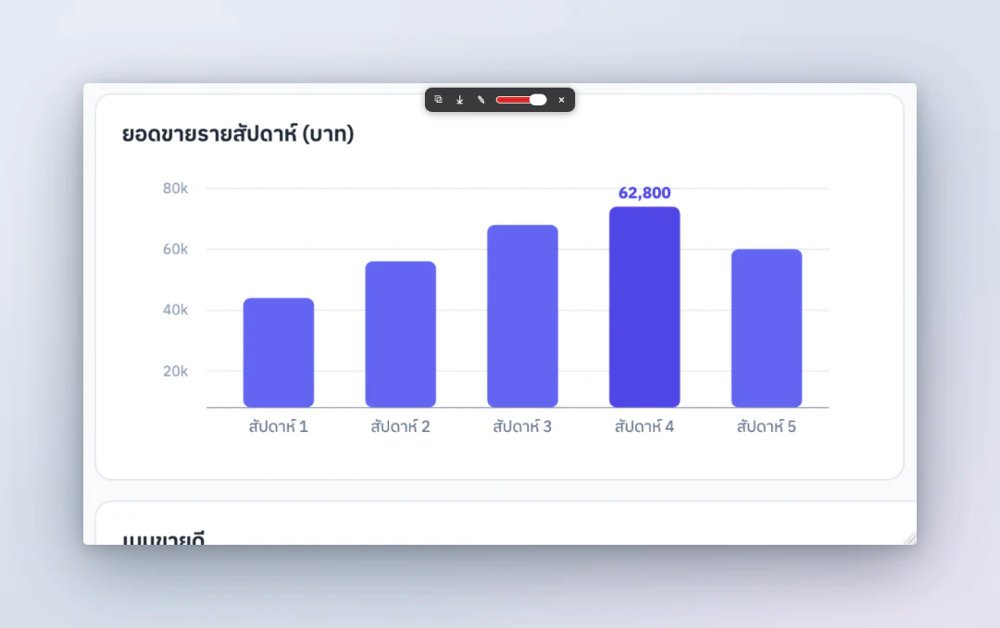</a><br><sub><b>ปักหมุด</b> ภาพลอยบนจอ</sub> |
| <a href="docs/USER-GUIDE-TH.md#6-อ่าน-qr--ดูดสี--ไม้บรรทัดพิกเซล">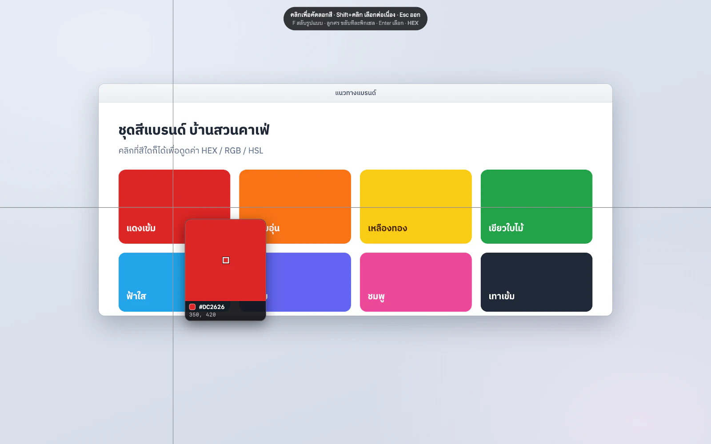</a><br><sub><b>ดูดสี · ไม้บรรทัด · QR</b></sub> | <a href="docs/USER-GUIDE-TH.md#8-สกรอลล์จับภาพ">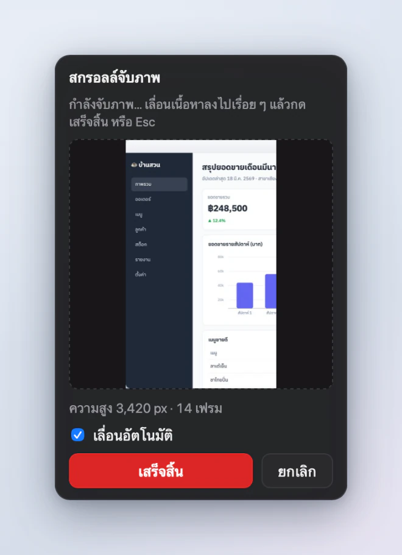</a><br><sub><b>สกรอลล์จับภาพ</b></sub> | <a href="docs/USER-GUIDE-TH.md#9-บันทึกหน้าจอ-และหน้าต่างวิดีโอ">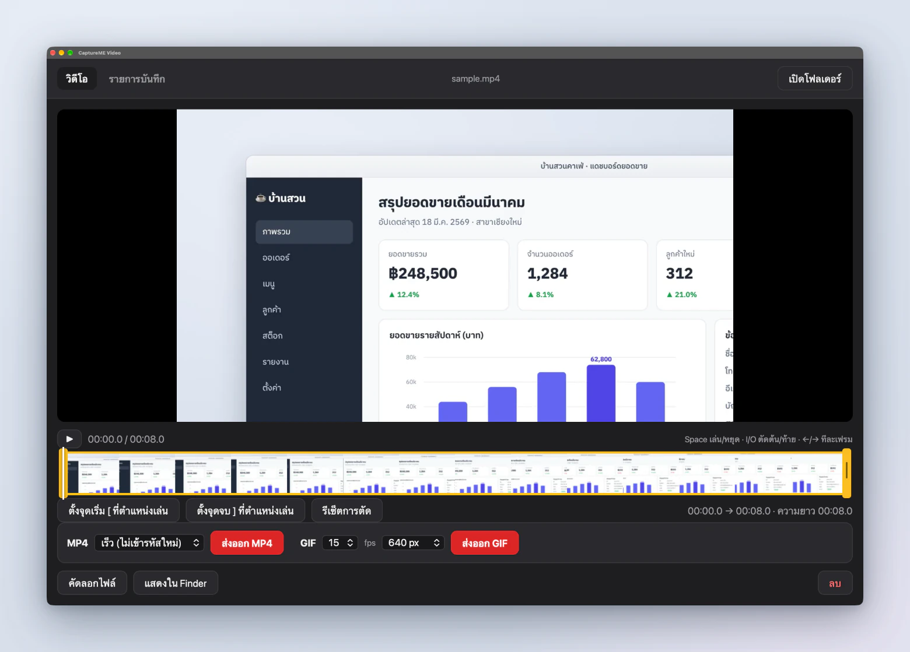</a><br><sub><b>บันทึกหน้าจอ</b> + ตัดต่อ MP4/GIF</sub> |

➡️ **[คู่มือใช้งานทีละเครื่องมือ (ไทย)](docs/USER-GUIDE-TH.md)** · **[User guide, tool by tool (English)](docs/USER-GUIDE-EN.md)**

---

## ภาษาไทย

**CaptureME** เป็นแอปจับภาพหน้าจอสำหรับ macOS ที่ทำงานอยู่บนแถบเมนู **ใช้ฟรี ไม่มีโฆษณา ไม่มีบัญชีผู้ใช้ ไม่เก็บข้อมูล และไม่ใช้อินเทอร์เน็ตเลย** สร้างโดย Sitthichat เพื่อแจกให้ทุกคนใช้ ซอร์สโค้ดเปิดเผยทั้งหมด

### ✨ ฟีเจอร์
| | ฟีเจอร์ | รายละเอียด |
|---|---|---|
| 🖼️ | **จับภาพ 3 แบบ** | พื้นที่ (ลากเลือก) · หน้าต่าง (คลิก ได้เงาหน้าต่างด้วย) · เต็มหน้าจอ – รองรับหลายจอและ Retina มีแว่นขยายพิกเซล + รหัสสี และ**ขนาดสำเร็จรูป** (1:1, 4:3, 16:9, 1280×720, 1920×1080, กำหนดเอง) |
| 🔁 | **จับซ้ำพื้นที่เดิม** · **หน่วงเวลา** | จับพื้นที่เดิมซ้ำด้วยคีย์ลัดเดียว · หน่วง 3 / 5 / 10 วินาทีสำหรับเมนูและ tooltip |
| 🧩 | **ภาพย่อมุมจอ** | หลังจับภาพเลือกได้: เปิดตัวแก้ไข / ภาพย่อ (แก้ไข คัดลอก บันทึก ปักหมุด หรือ**ลากออก**ไป Finder/Mail) / คัดลอกอย่างเดียว / บันทึกอย่างเดียว |
| ✏️ | **ตัวแก้ไขภาพ 20+ เครื่องมือ** | ลูกศร (ตรง/โค้ง/สองหัว/เรียว) · เส้น · สี่เหลี่ยม · วงรี · ปากกา · ไฮไลต์ · ข้อความ · ตัวนับลำดับ · ฟองคำพูด · กล่องมาร์กเกอร์ · ขีดเส้นใต้/ขีดฆ่า · วัดระยะ · เบลอ · โมเสก · **ปิดทึบ (Redact)** · สปอตไลต์ (หรี่/เบลอรอบนอก) · แว่นขยาย · สติกเกอร์ · ดูดสี |
| 🛠️ | **จัดการวัตถุ** | จัดกลุ่ม · ล็อก · จัดวาง/กระจาย · ทำสำเนา · เลิกทำ/ทำซ้ำ · เรียงปุ่มเครื่องมือเองได้ (ปุ่ม 1–9) · ปุ่ม `?` แสดงคีย์ลัดทั้งหมด |
| ✂️ | **ภาพ & ส่งออก** | ครอปตามสัดส่วน · ปรับขนาดภาพ/แคนวาส · หมุน/พลิก · เพิ่มขอบ/กรอบ · แทรกรูป (วางหรือลากไฟล์) · **ลายน้ำ** · สเกลส่งออก · บันทึก PNG/JPG/WebP · คัดลอกที่อยู่ไฟล์ |
| 🌄 | **พื้นหลังตกแต่ง** | พื้นหลังไล่สี ระยะขอบ มุมโค้ง และเงา ให้ภาพสวยพร้อมโพสต์ |
| 📌 | **ปักหมุด** | วางภาพลอยบนหน้าจอ (ปักพื้นที่ใดก็ได้) ปรับความโปร่งใส |
| 🔤 | **OCR ไทย + อังกฤษ** | อ่านข้อความจากภาพบนเครื่อง (Apple Vision) แล้วคัดลอก |
| 🎯 | **ดูดสี · ไม้บรรทัดพิกเซล · QR** | ดูดสีจากหน้าจอ (HEX/RGB/HSL + ประวัติสี) · วัดขนาดอัตโนมัติ (pt และ px) · อ่าน QR/บาร์โค้ด (ลิงก์ไม่เปิดเองจนกว่าคุณจะยืนยัน) |
| 📋 | **เขียนกำกับรูปจากคลิปบอร์ด** | ⌃⇧V เปิดรูปที่คัดลอกไว้ในตัวแก้ไข · เปิดรูปจากไฟล์ได้จากเมนู |
| 📜 | **สกรอลล์จับภาพ** | ต่อภาพหน้าเว็บ/เอกสารที่ยาวเป็นภาพเดียว (สูงสุด 30,000 px) มี *เลื่อนอัตโนมัติ* |
| 🎬 | **บันทึกหน้าจอ** | MP4 · MOV · GIF ทั้งจอ/พื้นที่/หน้าต่าง · เสียงระบบ + ไมโครโฟน · เว็บแคมลอยในวิดีโอ · แสดงคลิก/ปุ่มที่กด · พัก/บันทึกต่อ · คุณภาพ/ตัวเข้ารหัส (H.264/HEVC) · **หน้าต่างวิดีโอ**: ตัดต้น-ท้าย ลบเสียง ส่งออก MP4/GIF |
| 🕘 | **ประวัติ** | ทุกภาพถูกเก็บไว้ กรองตามวัน เปิดแก้ไข คัดลอก ปักหมุด หรือลบได้ |
| ⚙️ | **ตั้งค่า** | ไทย/อังกฤษ · โฟลเดอร์และรูปแบบชื่อไฟล์ · PNG/JPG/WebP · คีย์ลัดปรับเอง/ปิดได้ · เปิดอัตโนมัติ · **ลบข้อมูลทั้งหมด** ในปุ่มเดียว |

### 📥 ดาวน์โหลดและติดตั้ง
> ต้องใช้ macOS 14 (Sonoma) ขึ้นไป · รองรับทั้ง Apple Silicon (M1–M4) และ Intel

ทำตาม **[คู่มือติดตั้งพร้อมภาพจริง](docs/INSTALL-TH.md)**: ① ดาวน์โหลด `.dmg` จาก [Releases](https://github.com/POBIM/captureme/releases/latest) → ② ลากไปที่ Applications → ③ เปิดครั้งแรก/*Open Anyway* (แอปไม่ได้ลงนามกับ Apple ค่าสมาชิก $99/ปี – เราเลือกแจกฟรี) → ④ อนุญาต *Screen Recording* แล้วเปิดแอปใหม่ → ⑤ หาไอคอนบนแถบเมนูแล้วกด `⌃⇧2`

ทางลัด Terminal (แก้ได้ทั้งกรณี "แอปเสียหาย"): `xattr -dr com.apple.quarantine /Applications/CaptureME.app`

### ⌨️ คีย์ลัดเริ่มต้น
| การทำงาน | คีย์ลัด |
|---|---|
| จับภาพเต็มหน้าจอ | `⌃⇧1` |
| จับภาพพื้นที่ | `⌃⇧2` |
| จับภาพหน้าต่าง | `⌃⇧3` |
| จับซ้ำพื้นที่เดิม | `⌃⇧4` |
| จับภาพหน่วงเวลา (5 วินาที) | `⌃⇧5` |
| สกรอลล์จับภาพ | `⌃⇧6` |
| บันทึกหน้าจอ (กดอีกครั้งเพื่อหยุด) | `⌃⇧7` |
| OCR – อ่านข้อความจากภาพ | `⌃⇧8` |
| เปิดประวัติ | `⌃⇧9` |
| ปักหมุดพื้นที่ | `⌃⇧P` |
| ดูดสีจากหน้าจอ | `⌃⇧C` |
| ไม้บรรทัดพิกเซล | `⌃⇧M` |
| อ่าน QR / บาร์โค้ด | `⌃⇧Q` |
| เขียนกำกับรูปจากคลิปบอร์ด | `⌃⇧V` |

> เลือกชุด `⌃⇧` เพื่อไม่ชนกับคีย์ลัดภาพหน้าจอของ macOS (`⌘⇧3/4/5`) ปรับหรือปิดได้ทุกตัวที่ **ตั้งค่า › ปุ่มลัด**

### 🔒 ความเป็นส่วนตัว
ไม่เก็บข้อมูล · ไม่มี telemetry · ไม่มีโฆษณา · **ไม่ใช้อินเทอร์เน็ต** · ภาพและประวัติอยู่ในเครื่องคุณเท่านั้น

สิทธิ์ของ macOS ที่ขอ: **Screen Recording** (จำเป็น) · และ *เฉพาะเมื่อคุณใช้ฟีเจอร์นั้น* → **Accessibility** (เลื่อนอัตโนมัติ) · **Microphone** (บันทึกเสียง) · **Camera** (เว็บแคมลอยในวิดีโอ) · **Input Monitoring** (แสดงปุ่มที่กดในวิดีโอ) อ่านรายละเอียดและวิธีลบข้อมูลที่ [PRIVACY.md](PRIVACY.md)

### 🛠️ สร้างจากซอร์สโค้ด
ต้องมี macOS, Xcode command-line tools, [Rust](https://rustup.rs), Node.js 20+
```bash
git clone https://github.com/POBIM/captureme.git && cd captureme
npm ci
npm run tauri dev                       # รันแบบพัฒนา
scripts/build-installer.sh              # สร้าง release/CaptureME_<ver>_universal.dmg + .zip + SHA256SUMS.txt
scripts/build-installer.sh --native     # เฉพาะสถาปัตยกรรมของเครื่องนี้ (เร็วกว่า)
scripts/install-local.sh                # ติดตั้งลง /Applications
```
ตรวจสอบก่อนส่ง PR: `npm run build` และ `cd src-tauri && cargo build`

### 🗑️ ถอนการติดตั้ง
ออกจากแอป (ไอคอนบนแถบเมนู › ออกจาก CaptureME) → ลาก `CaptureME.app` ไปถังขยะ → ลบข้อมูลตามหัวข้อ *"วิธีลบข้อมูลทั้งหมด"* ใน [PRIVACY.md](PRIVACY.md)

### ❓ คำถามที่พบบ่อย
<details><summary><b>ใช้ฟรีจริงไหม? ใช้เชิงพาณิชย์ได้หรือเปล่า?</b></summary>
ฟรีจริง ไม่มีฟีเจอร์ล็อก ไม่มีโฆษณา ใช้ได้ทั้งส่วนตัวและเชิงพาณิชย์ ตามสัญญาอนุญาต MIT
</details>
<details><summary><b>ทำไม macOS บอกว่า "ไม่สามารถตรวจสอบได้" / "เสียหาย"?</b></summary>
เพราะแอปไม่ได้ลงนามกับ Apple (ไม่มี Developer ID / notarization) ปลอดภัยที่จะเปิดถ้าดาวน์โหลดจากหน้า Releases ของโปรเจกต์นี้ – ทำตามขั้นตอน <b>Open Anyway</b> ด้านบน และตรวจ SHA-256 ได้ด้วย <code>shasum -a 256 -c SHA256SUMS.txt</code>
</details>
<details><summary><b>ภาพที่จับเป็นสีดำ / เห็นแต่วอลเปเปอร์</b></summary>
ยังไม่ได้อนุญาต Screen Recording – เปิดให้ CaptureME แล้ว <b>ปิดแล้วเปิดแอปใหม่</b>
</details>
<details><summary><b>อนุญาตแล้วแต่หลังอัปเดตแอปใช้ไม่ได้อีก</b></summary>
แอปเซ็นแบบ ad-hoc ลายเซ็นเปลี่ยนทุกเวอร์ชัน macOS จึงจำสิทธิ์เดิมไม่ได้ ให้ลบ CaptureME ออกจากรายการ Screen Recording (ปุ่ม −) หรือรัน <code>tccutil reset ScreenCapture com.sitthichat.captureme</code> แล้วอนุญาตใหม่
</details>
<details><summary><b>macOS Sequoia/Tahoe ถามเรื่อง "อนุญาตการบันทึกหน้าจออีกครั้ง" ทุกเดือน</b></summary>
เป็นการทำงานของ macOS 15+ กับทุกแอปที่บันทึกหน้าจอ เลือก <i>อนุญาต (Allow)</i> ได้เลย
</details>
<details><summary><b>เลื่อนอัตโนมัติไม่ทำงาน</b></summary>
ต้องอนุญาต <b>Accessibility</b> ให้ CaptureME และวางเมาส์ไว้เหนือเนื้อหาที่จะเลื่อน
</details>
<details><summary><b>OCR ภาษาไทยอ่านไม่ออก</b></summary>
OCR ภาษาไทยของ Apple Vision ต้องใช้ macOS 14 ขึ้นไป และแม่นยำที่สุดกับตัวอักษรชัด ๆ ขนาดไม่เล็กเกินไป
</details>

### 🤝 ร่วมพัฒนา (Contributing)
ยินดีรับทุกความช่วยเหลือ – แจ้งบั๊ก เสนอไอเดีย แปลภาษา หรือส่ง Pull Request
1. Fork แล้วสร้าง branch (`git checkout -b feature/ชื่อฟีเจอร์`)
2. ให้ `npm run build` และ `cd src-tauri && cargo build` ผ่านก่อน commit
3. ข้อความ UI ต้องมีทั้งไทยและอังกฤษ (ดู `src/i18n/`)
4. อย่าเพิ่มการเชื่อมต่อเครือข่ายหรือ telemetry – นี่คือหลักการสำคัญของโปรเจกต์
5. เปิด Pull Request พร้อมคำอธิบายและภาพหน้าจอ

ทุกคนควรสุภาพและให้เกียรติกัน (แนวทางเดียวกับ [Contributor Covenant](https://www.contributor-covenant.org/version/2/1/code_of_conduct/))

### 📄 สัญญาอนุญาต
**MIT License** – © 2026 Sitthichat
**ใช้ฟรี · แจกต่อได้ · แก้ไขได้ · ไม่มีค่าใช้จ่าย · ไม่มีการรับประกันใด ๆ** (ผู้พัฒนาไม่รับผิดชอบต่อความเสียหายจากการใช้งาน) โปรดคงข้อความลิขสิทธิ์และไฟล์ [LICENSE](LICENSE) ไว้เมื่อแจกจ่ายต่อ

---

## English

**CaptureME** is a menu-bar screenshot & annotation app for macOS. **Free, no ads, no account, no data collection – and it never touches the internet.** Made by Sitthichat for everyone; the full source is open.

### ✨ Features
| | Feature | Details |
|---|---|---|
| 🖼️ | **3 capture modes** | Region (drag) · Window (click, optional window shadow) · Full screen – multi-monitor & Retina aware, pixel loupe with colour code, and **size presets** (1:1, 4:3, 16:9, 1280×720, 1920×1080, custom) |
| 🔁 | **Repeat last region** · **Delayed capture** | Re-capture the previous area with one shortcut · 3 / 5 / 10 s timer for menus & tooltips |
| 🧩 | **Floating thumbnail** | After a capture choose: open editor / thumbnail (edit, copy, save, pin or **drag it out** into Finder/Mail) / copy only / save only |
| ✏️ | **Annotation editor, 20+ tools** | Arrow (straight / curved / double / tapered) · line · rectangle · ellipse · pen · highlighter · text · step counter · callout · marker box · underline / strike · measure · blur · pixelate · **solid redact** · spotlight (dim / blur outside) · magnifier · stamps · colour picker |
| 🛠️ | **Object handling** | Group · lock · align / distribute · duplicate · undo / redo · reorder the toolbar yourself (keys 1–9) · press `?` for every shortcut |
| ✂️ | **Image & export** | Aspect-ratio crop · resize image / canvas · rotate / flip · padding / border · insert images (paste or drop) · **watermark** · export scale · save PNG/JPG/WebP · copy file path |
| 🌄 | **Beautify background** | Gradient background, padding, rounded corners and shadow for share-ready shots |
| 📌 | **Pin to screen** | Float an image (pin any region) above all windows, adjust opacity |
| 🔤 | **OCR Thai + English** | On-device text recognition (Apple Vision), then copy |
| 🎯 | **Colour picker · pixel ruler · QR** | Pick colours from the screen (HEX/RGB/HSL + colour history) · auto-measure anything (pt and px) · read QR / barcodes (links never open without your confirmation) |
| 📋 | **Annotate clipboard image** | ⌃⇧V opens the copied image in the editor · open an image file from the menu |
| 📜 | **Scrolling capture** | Stitch long pages / documents into one image (up to 30 000 px) with *Auto-scroll* |
| 🎬 | **Screen recording** | MP4 · MOV · GIF of the screen / a region / a window · system audio + microphone · floating webcam bubble · click rings & key display · pause / resume · quality & codec (H.264/HEVC) · **video window**: trim, mute, export MP4/GIF |
| 🕘 | **History** | Every capture is kept – filter by day, re-open, edit, copy, pin or delete |
| ⚙️ | **Settings** | Thai / English · folder & filename pattern · PNG/JPG/WebP · custom / disabled shortcuts · launch at login · one-click **remove all data** |

### 📥 Download & install
> Requires macOS 14 (Sonoma) or later · Apple Silicon (M1–M4) **and** Intel

<p align="center">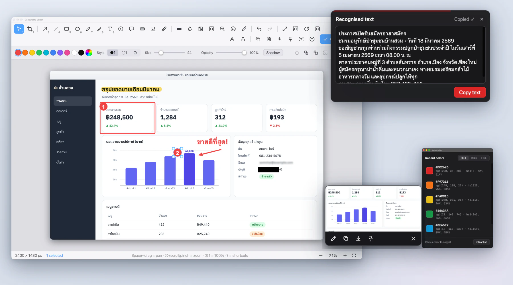</p>

Follow the **[illustrated install guide](docs/INSTALL-EN.md)**: ① download the `.dmg` from [Releases](https://github.com/POBIM/captureme/releases/latest) → ② drag it to Applications → ③ first launch / *Open Anyway* (the app is not signed with a $99/year Apple ID – we chose to stay free) → ④ allow *Screen Recording* and reopen → ⑤ find the menu-bar icon and press `⌃⇧2`.

Terminal shortcut (also fixes "is damaged"): `xattr -dr com.apple.quarantine /Applications/CaptureME.app`

### ⌨️ Default shortcuts
| Action | Shortcut |
|---|---|
| Capture full screen | `⌃⇧1` |
| Capture region | `⌃⇧2` |
| Capture window | `⌃⇧3` |
| Repeat last region | `⌃⇧4` |
| Delayed capture (5 s) | `⌃⇧5` |
| Scrolling capture | `⌃⇧6` |
| Record screen (press again to stop) | `⌃⇧7` |
| OCR – read text from the screen | `⌃⇧8` |
| Open history | `⌃⇧9` |
| Pin region | `⌃⇧P` |
| Colour picker | `⌃⇧C` |
| Pixel ruler | `⌃⇧M` |
| QR / barcode reader | `⌃⇧Q` |
| Annotate clipboard image | `⌃⇧V` |

> The `⌃⇧` set avoids macOS's own screenshot shortcuts (`⌘⇧3/4/5`). Change or disable any of them in **Settings › Hotkeys**.

### 🔒 Privacy
No data collected · no telemetry · no ads · **no network access** · images and history never leave your Mac.

macOS permissions: **Screen Recording** (required) and, *only when you use that feature* → **Accessibility** (Auto-scroll) · **Microphone** (voice) · **Camera** (webcam bubble in videos) · **Input Monitoring** (show pressed keys in videos). Details and how to delete everything: [PRIVACY.md](PRIVACY.md).

### 🛠️ Build from source
Requires macOS, Xcode command-line tools, [Rust](https://rustup.rs), Node.js 20+.
```bash
git clone https://github.com/POBIM/captureme.git && cd captureme
npm ci
npm run tauri dev                       # development run
scripts/build-installer.sh              # → release/CaptureME_<ver>_universal.dmg + .zip + SHA256SUMS.txt
scripts/build-installer.sh --native     # this Mac's architecture only (faster)
scripts/install-local.sh                # install into /Applications
```
Before opening a PR: `npm run build` and `cd src-tauri && cargo build` must pass.

Optional signing & notarisation – set before running the script: `APPLE_SIGNING_IDENTITY`, and `APPLE_ID` + `APPLE_TEAM_ID` + `APPLE_PASSWORD` (app-specific password).

### 🗑️ Uninstall
Quit the app (menu-bar icon › Quit CaptureME) → drag `CaptureME.app` to the Trash → delete leftovers as described under *Delete all data* in [PRIVACY.md](PRIVACY.md).

### ❓ FAQ
<details><summary><b>Is it really free? Can I use it commercially?</b></summary>
Yes. No locked features, no ads. Personal and commercial use are both allowed under the MIT license.
</details>
<details><summary><b>Why does macOS say it "cannot verify" the app / that it is "damaged"?</b></summary>
Because the app is not signed with an Apple Developer ID or notarised. It is safe to open when downloaded from this project's Releases page – follow the <b>Open Anyway</b> steps above, and verify the download with <code>shasum -a 256 -c SHA256SUMS.txt</code>.
</details>
<details><summary><b>Screenshots are black / only show the wallpaper</b></summary>
Screen Recording is not allowed yet – enable CaptureME, then <b>quit and reopen the app</b>.
</details>
<details><summary><b>I granted permission but it stopped working after an update</b></summary>
The app is ad-hoc signed and its signature changes with every build, so macOS forgets the permission. Remove CaptureME from the Screen Recording list (− button) or run <code>tccutil reset ScreenCapture com.sitthichat.captureme</code>, then allow it again.
</details>
<details><summary><b>macOS Sequoia/Tahoe asks monthly to "allow screen recording again"</b></summary>
That is macOS 15+ behaviour for every screen-recording app. Choose <i>Allow</i>.
</details>
<details><summary><b>Auto-scroll does nothing</b></summary>
Allow <b>Accessibility</b> for CaptureME and keep the pointer over the content you want to scroll.
</details>
<details><summary><b>Thai OCR does not work</b></summary>
Apple Vision's Thai recognition needs macOS 14+; it works best on clear text that is not tiny.
</details>

### 🤝 Contributing
Bug reports, ideas, translations and pull requests are all welcome.
1. Fork and create a branch (`git checkout -b feature/my-feature`).
2. Make sure `npm run build` and `cd src-tauri && cargo build` pass.
3. Every UI string needs Thai **and** English (see `src/i18n/`).
4. Never add network access or telemetry – that is a core principle of the project.
5. Open a Pull Request with a description and screenshots.

Be kind and respectful (we follow the [Contributor Covenant](https://www.contributor-covenant.org/version/2/1/code_of_conduct/)).

### 📄 License
**MIT License** – © 2026 Sitthichat. Free to use, share and modify, no warranty. Keep the copyright notice and the [LICENSE](LICENSE) file when redistributing.

Project layout: `src-tauri/` (Rust, Tauri 2) · `src/` (TypeScript pages) · `scripts/` (installer) · `docs/` (install & user guides, real screenshots; developer notes in [`docs/dev/`](docs/dev/)) · `marketing/` (posters, social cards & tutorial video built from real captures – [how to regenerate](marketing/README.md)).

---
<sub>Created in [T3 Code](https://t3.codes).</sub>
