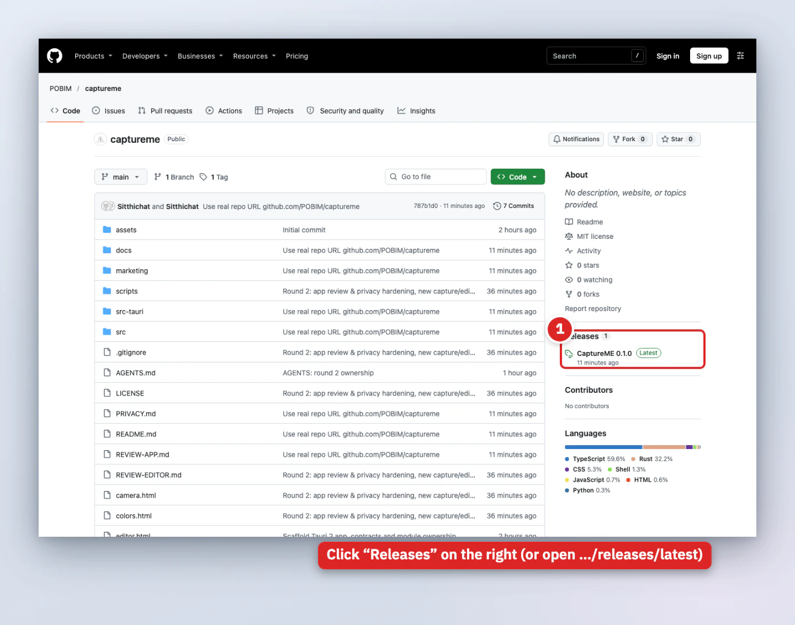
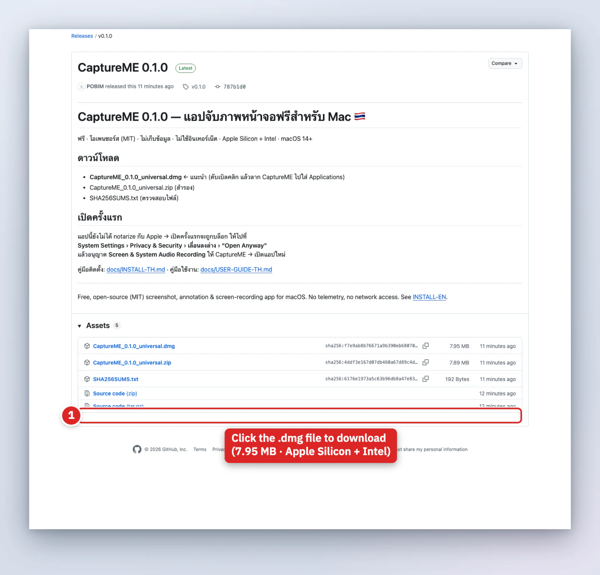
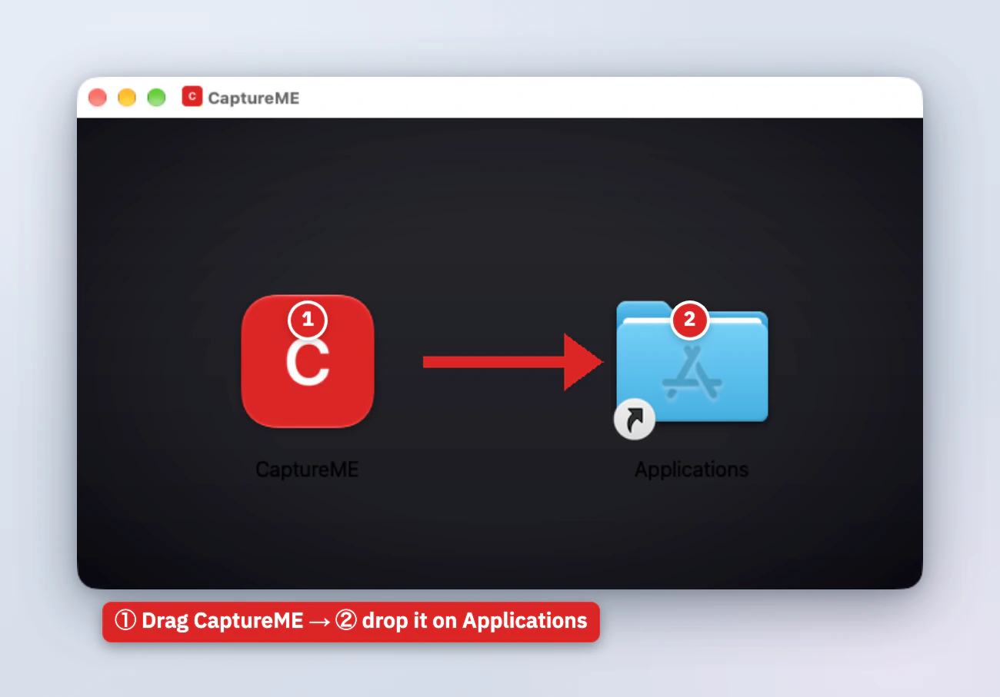
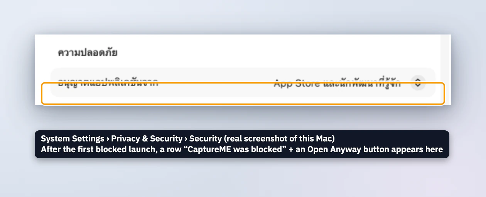
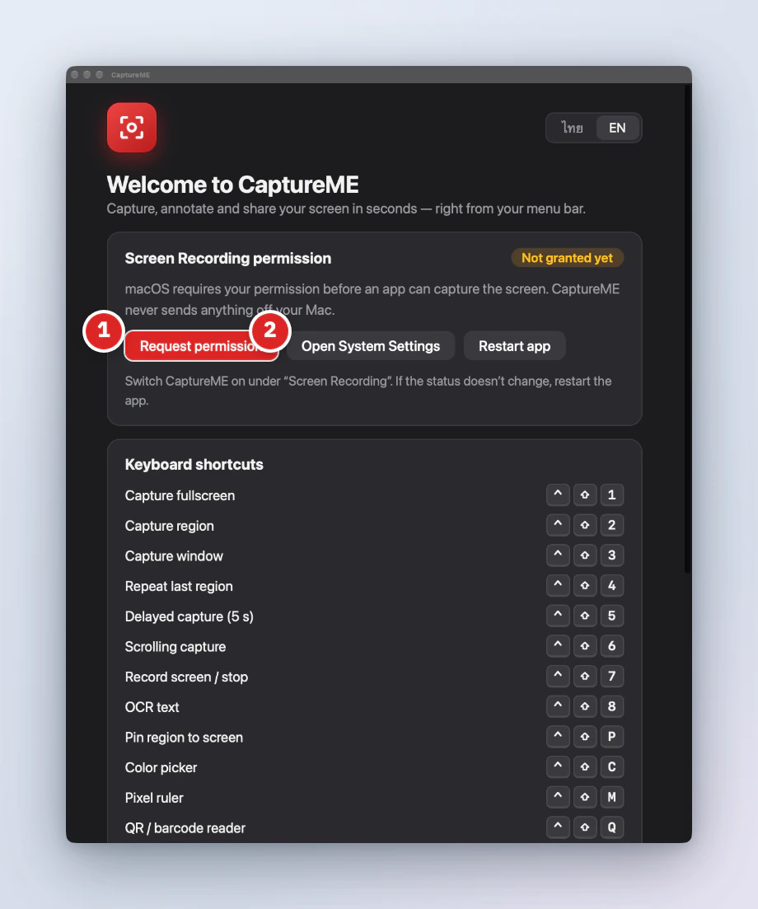
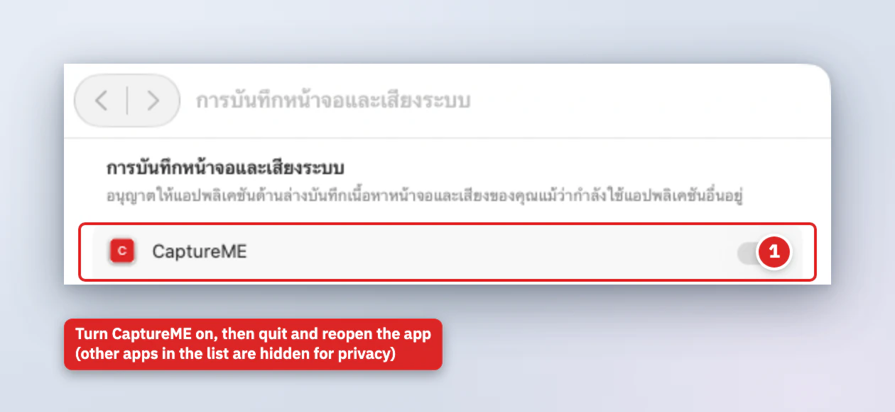
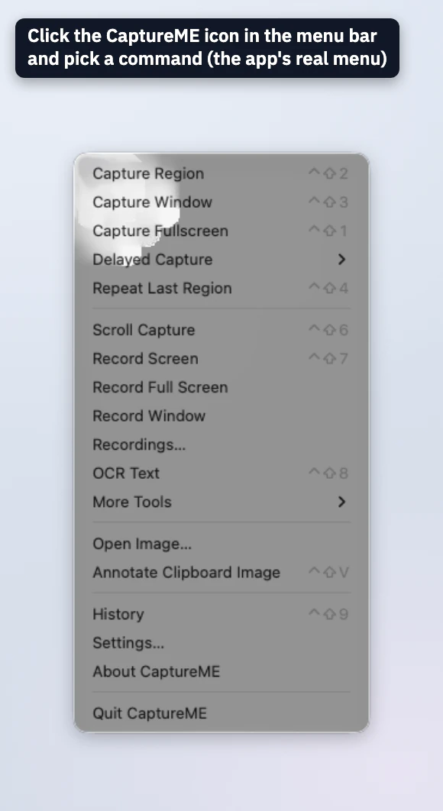
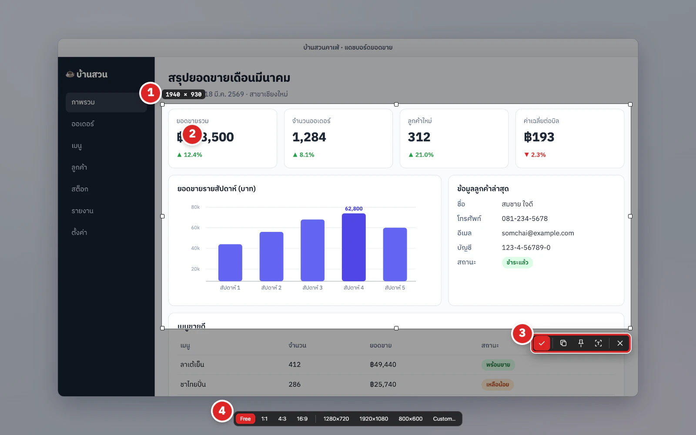

# CaptureME – Installation guide (English)

[ภาษาไทย](INSTALL-TH.md) · [User guide](USER-GUIDE-EN.md) · [← README](../README.md)

CaptureME is free, collects no data and never uses the internet. Installing takes 5 steps (~3 minutes).

> 🖼️ Every picture in this guide is **real**: the GitHub web pages, the Finder window of the DMG, the macOS System Settings pages and the app's own windows, captured as they are (we only add the red numbered circles, boxes and captions).
> ⚠️ The Mac used for the screenshots runs macOS in Thai. If your macOS uses another language, System Settings labels will differ (English names are given in the text), and other macOS versions may look slightly different.

## System requirements
- **macOS 14 (Sonoma) or newer** – including macOS 15 Sequoia and macOS 26/27
- **Apple Silicon (M1–M4) or Intel** Mac – the DMG is *universal*
- ~50 MB of free space

---

## Step 1 – Download from GitHub


1. Open **https://github.com/POBIM/captureme** and click **Releases** in the right column – or go straight to **https://github.com/POBIM/captureme/releases/latest**



2. Scroll to **Assets** and click **`CaptureME_<version>_universal.dmg`** (about 8 MB). It lands in your *Downloads* folder.
3. (Recommended) Verify the download: save `SHA256SUMS.txt` next to it and run in Terminal
   ```bash
   cd ~/Downloads && shasum -a 256 -c SHA256SUMS.txt --ignore-missing
   ```
   You should see `CaptureME_..._universal.dmg: OK`.

## Step 2 – Drag it into Applications


1. Double-click the `.dmg` → this window opens (if a licence text appears, click *Agree* – it is the project's MIT licence).
2. **Drag the CaptureME icon onto the Applications folder** in the same window.
3. When the copy finishes, eject the disk (right-click *CaptureME* in the Finder sidebar › *Eject*, or press ⏏).

## Step 3 – First launch (Open Anyway)
The app is not signed with an Apple Developer ID ($99/year – we chose to stay free), so macOS Gatekeeper blocks the first launch. **It is not a virus** – do this once.



**Method 1 – System Settings (macOS 15 and later, incl. 27)**
1. Open the *Applications* folder and double-click **CaptureME**.
2. A message says *Apple could not verify "CaptureME" is free of malware…* → click **Done** (do **not** choose "Move to Trash").
3. Open **System Settings › Privacy & Security** and scroll to the **Security** section (the picture above is this page).
4. You will see *"CaptureME" was blocked to protect your Mac* with an **Open Anyway** button → click it.
5. Enter your password / Touch ID and click **Open Anyway** once more in the confirmation box.

> 📝 **About this picture, honestly:** the *Open Anyway* button only appears after you tried to open the app and it was blocked (and stays for about an hour). When we took the screenshot this Mac was not blocking the app, so the button is not in the picture – we only mark where it will appear.
>
> macOS 14 and older: right-click the app › **Open** › **Open** also works (removed in macOS 15+).

**Method 2 – Terminal (fastest; also fixes the "app is damaged" message)**
```bash
xattr -dr com.apple.quarantine /Applications/CaptureME.app
open /Applications/CaptureME.app
```

## Step 4 – Allow Screen Recording
macOS requires your permission before an app may read the screen.



1. On first launch CaptureME shows this **welcome window** (real) – if not allowed yet it says *Not granted*; click **① Request permission** or **② Open System Settings**.



2. In **System Settings › Privacy & Security › Screen & System Audio Recording** turn **CaptureME** on.
3. macOS asks to quit the app – choose **Quit & Reopen** (or *Later*) and **start CaptureME again** (or click *Restart app* in the welcome window).

   *(The picture is cropped to the CaptureME row – the other apps in that list are hidden for privacy.)*

Optional permissions macOS asks for only when you use a feature: **Accessibility** (auto-scroll), **Microphone**, **Camera** (webcam bubble), **Input Monitoring** (show pressed keys) – see [PRIVACY.md](../PRIVACY.md#english).

## Step 5 – Find the menu-bar icon and take your first capture


1. Look for the **viewfinder icon** in the menu bar at the top right (there is no Dock icon) → click it to open the menu with every tool and its shortcut.
2. Try it: press **`⌃⇧2`**, drag a region and click **Confirm** (if the picture is not black, you are done 🎉).



3. The capture opens in the editor for annotation (see the [user guide](USER-GUIDE-EN.md)). To start with your Mac: *Settings › General › Launch at login*.

---

## Updating
1. Quit the app (menu-bar icon › Quit CaptureME).
2. Download the new DMG from [Releases](https://github.com/POBIM/captureme/releases/latest) and drag it over the old one in Applications.
3. Repeat step 3 if macOS blocks it again.
4. The ad-hoc signature changes with every version, so **Screen Recording must be re-allowed**: select CaptureME in the permission list, press **−**, and reopen the app to be asked again – or run
   ```bash
   tccutil reset ScreenCapture com.sitthichat.captureme
   ```
> macOS 15+ may ask monthly to confirm screen recording – choose *Allow*.

## Troubleshooting
| Symptom | Fix |
|---|---|
| No *Open Anyway* button | Try to open the app once, then open Privacy & Security within ~1 hour |
| "CaptureME is damaged" | `xattr -dr com.apple.quarantine /Applications/CaptureME.app` |
| Captures are black / only wallpaper | Screen Recording not allowed yet, or the app was not restarted |
| Stopped working after an update | `tccutil reset ScreenCapture com.sitthichat.captureme`, then allow again |
| A shortcut does nothing | It may clash with another app – change or disable it in Settings › Hotkeys |
| Menu-bar icon not visible | The menu bar may be full / hidden by the notch – quit other menu-bar apps or use the shortcuts |
| Thai OCR returns nothing | Needs macOS 14+ and clear, not-too-small text |

## Uninstall
1. Quit the app (menu-bar icon › Quit CaptureME).
2. (To delete your data too) first open the app › *Settings › About › Delete all CaptureME data…*
3. Drag `CaptureME.app` from Applications to the Trash.
4. More details: [PRIVACY.md – remove all data](../PRIVACY.md#english).
