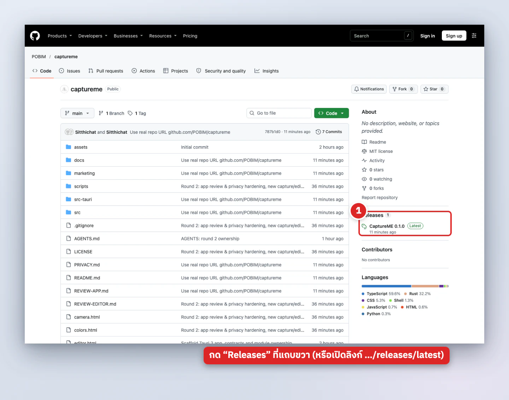
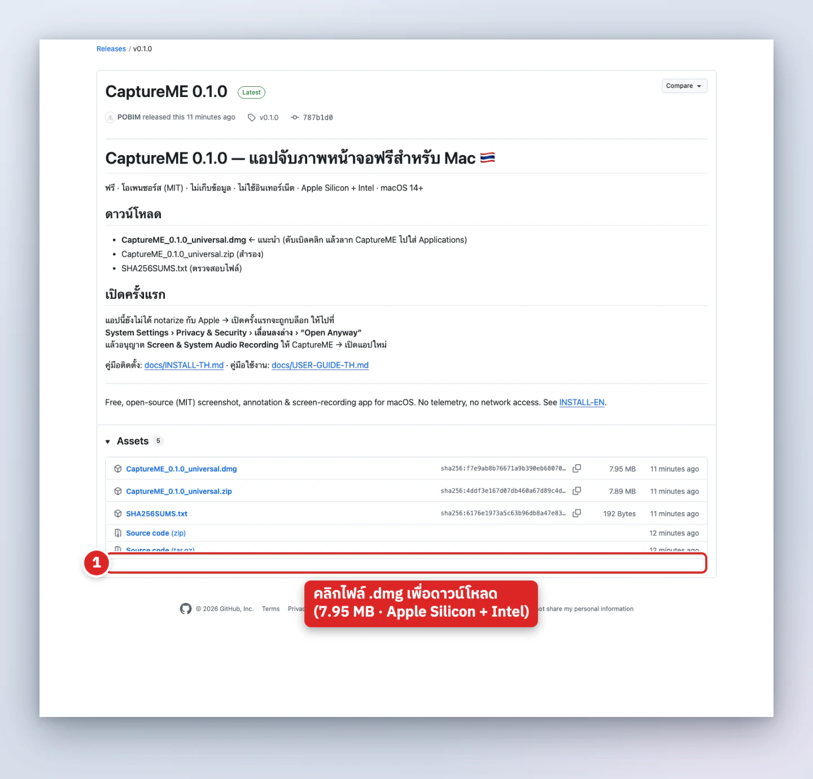
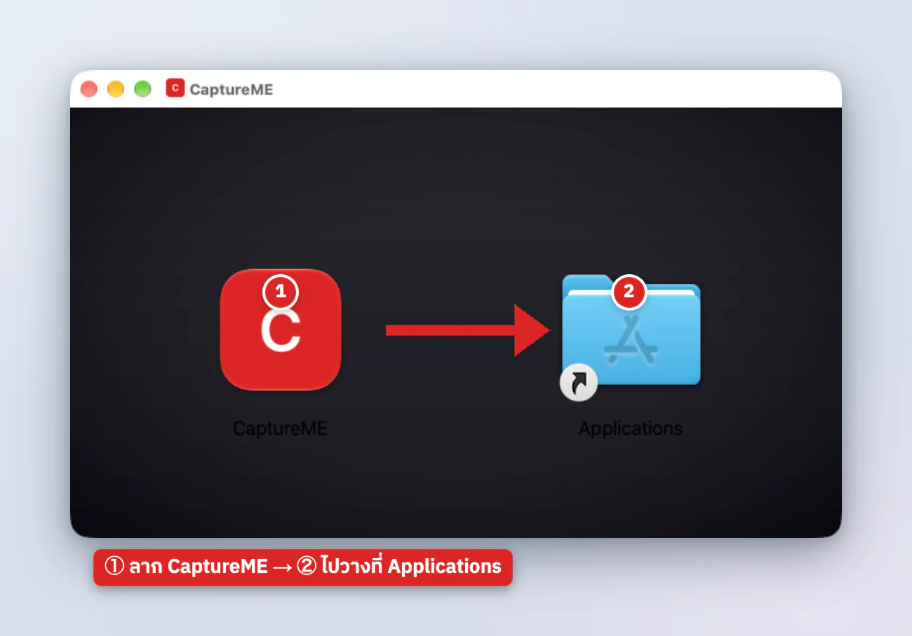
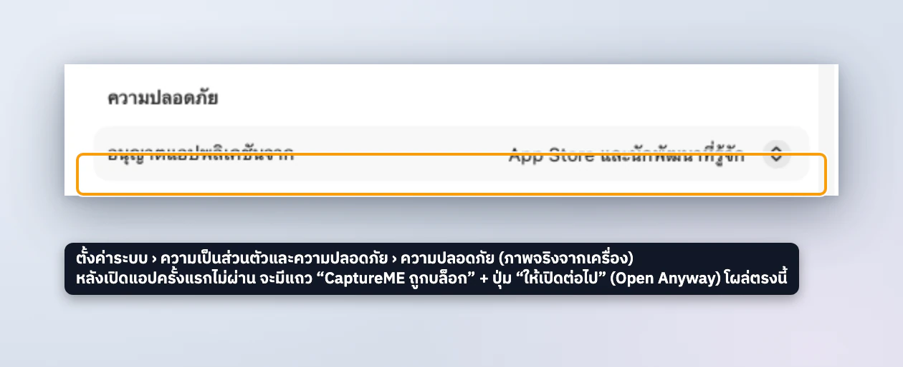
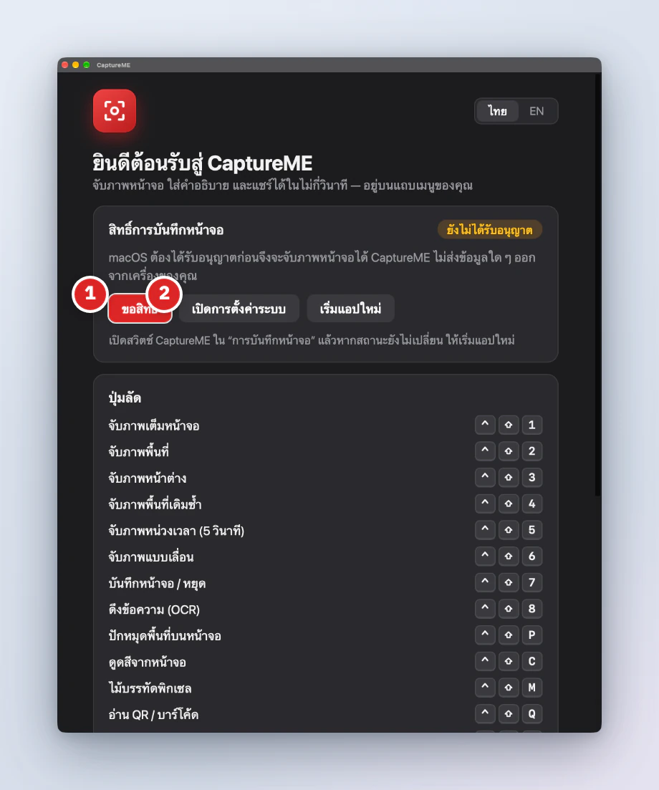
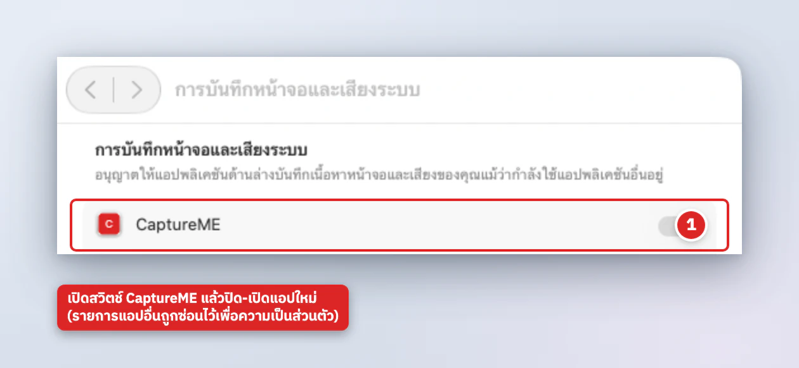
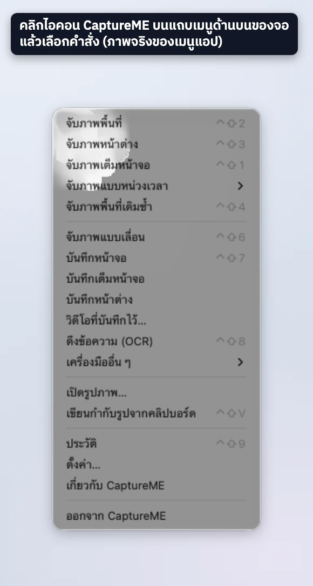
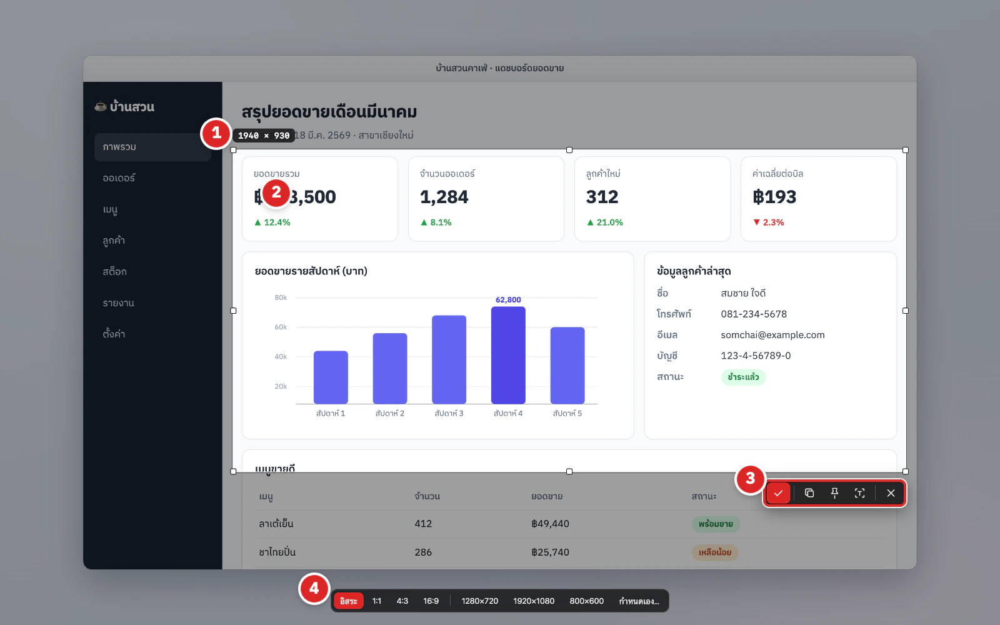

# คู่มือติดตั้ง CaptureME (ภาษาไทย)

[English](INSTALL-EN.md) · [คู่มือใช้งาน](USER-GUIDE-TH.md) · [← README](../README.md)

CaptureME ใช้ฟรี ไม่เก็บข้อมูล ไม่ใช้อินเทอร์เน็ต ติดตั้งได้ใน 5 ขั้นตอน (~3 นาที)

> 🖼️ ภาพทุกภาพในคู่มือนี้เป็น **ของจริง**: หน้าเว็บ GitHub, หน้าต่าง Finder ของไฟล์ DMG, หน้าตั้งค่าระบบของ macOS และหน้าต่างของแอปที่รันอยู่จริง (เราเติมเพียงเลขวงกลมแดง กรอบ และคำอธิบาย)
> ⚠️ เครื่องที่ถ่ายภาพใช้ macOS ภาษาไทย – ถ้า macOS ของคุณเป็นภาษาอื่น ชื่อเมนูในตั้งค่าระบบจะต่างออกไป (เราใส่ชื่อภาษาอังกฤษกำกับไว้ให้) และหน้าตาของ macOS รุ่นอื่นอาจต่างเล็กน้อย

## ความต้องการของระบบ
- **macOS 14 (Sonoma) ขึ้นไป** – รวมถึง macOS 15 Sequoia และ macOS 26/27
- Mac **Apple Silicon (M1/M2/M3/M4) หรือ Intel** – ไฟล์ DMG เป็นแบบ *universal* ใช้ได้ทั้งคู่
- พื้นที่ว่างประมาณ 50 MB

---

## ขั้นตอนที่ 1 – ดาวน์โหลดจาก GitHub


1. เปิด **https://github.com/POBIM/captureme** แล้วกด **Releases** ที่แถบขวา – หรือไปตรง ๆ ที่ **https://github.com/POBIM/captureme/releases/latest**



2. เลื่อนลงไปที่ส่วน **Assets** แล้วคลิก **`CaptureME_<เวอร์ชัน>_universal.dmg`** (ประมาณ 8 MB) – ไฟล์จะลงในโฟลเดอร์ *ดาวน์โหลด*
3. (แนะนำ) ตรวจว่าไฟล์ไม่ถูกแก้ไข: ดาวน์โหลด `SHA256SUMS.txt` ไว้โฟลเดอร์เดียวกัน แล้วรันใน Terminal
   ```bash
   cd ~/Downloads && shasum -a 256 -c SHA256SUMS.txt --ignore-missing
   ```
   ต้องขึ้น `CaptureME_..._universal.dmg: OK`

## ขั้นตอนที่ 2 – ลากลงใน Applications


1. ดับเบิลคลิกไฟล์ `.dmg` → หน้าต่างนี้จะเปิดขึ้น (ถ้ามีข้อความสัญญาอนุญาต ให้กด *ยอมรับ/Agree* – เป็นสัญญา MIT ฉบับเดียวกับในโปรเจกต์)
2. **ลากไอคอน CaptureME ไปวางบนโฟลเดอร์ Applications** ในหน้าต่างเดียวกัน
3. รอคัดลอกเสร็จ แล้วเอาดิสก์ออก (คลิกขวาที่ *CaptureME* ในแถบข้างของ Finder › *นำออก* หรือกดปุ่มนำออก ⏏)

## ขั้นตอนที่ 3 – เปิดครั้งแรก (Open Anyway)
แอปไม่ได้ลงนามด้วย Apple Developer ID (ค่าสมาชิก Apple ปีละ $99 – เราเลือกแจกฟรี) จึงถูก Gatekeeper ของ macOS บล็อกในครั้งแรก **ไม่ใช่ไวรัส** – ทำครั้งเดียวเท่านั้น



**วิธีที่ 1 – ผ่านตั้งค่าระบบ (macOS 15 ขึ้นไป รวม 27)**
1. เปิดโฟลเดอร์ *Applications* แล้วดับเบิลคลิก **CaptureME**
2. ขึ้นกล่องข้อความว่า *Apple ไม่สามารถตรวจสอบได้ว่า "CaptureME" ปราศจากมัลแวร์…* → กด **เสร็จสิ้น (Done)** (อย่ากด "ย้ายไปที่ถังขยะ")
3. เปิด **ตั้งค่าระบบ (System Settings) › ความเป็นส่วนตัวและความปลอดภัย (Privacy & Security)** แล้วเลื่อนลงไปส่วน **ความปลอดภัย (Security)** (ภาพด้านบนคือหน้านี้จริง)
4. จะเห็นแถว *"CaptureME" ถูกบล็อกเพื่อป้องกัน Mac ของคุณ* พร้อมปุ่ม **ให้เปิดต่อไป (Open Anyway)** → กดปุ่ม
5. ใส่รหัสผ่านเครื่อง/Touch ID แล้วกด **เปิดต่อไป** อีกครั้งในกล่องยืนยัน

> 📝 **ความซื่อสัตย์ของภาพ:** ปุ่ม *Open Anyway* โผล่เฉพาะหลังจากที่คุณพยายามเปิดแอปแล้วถูกบล็อก (และอยู่ราว 1 ชั่วโมง) ตอนถ่ายภาพ macOS เครื่องนี้ไม่ได้บล็อกแอปอยู่ จึงยังไม่มีปุ่มในภาพ – เราจึงชี้ให้เห็นตำแหน่งที่ปุ่มจะปรากฏเท่านั้น
>
> macOS 14 และเก่ากว่า: คลิกขวาที่แอป › **เปิด** › **เปิด** ก็ใช้ได้ (macOS 15+ ตัดวิธีนี้ออกแล้ว)

**วิธีที่ 2 – Terminal (เร็วที่สุด และแก้ข้อความ "แอปเสียหาย / damaged" ได้)**
```bash
xattr -dr com.apple.quarantine /Applications/CaptureME.app
open /Applications/CaptureME.app
```

## ขั้นตอนที่ 4 – อนุญาต Screen Recording
macOS ต้องการให้คุณอนุญาตก่อนที่แอปจะอ่านภาพหน้าจอได้



1. เมื่อเปิดครั้งแรก CaptureME แสดง **หน้าต้อนรับ** (ภาพจริง) – ถ้ายังไม่อนุญาตจะมีป้าย *ยังไม่ได้อนุญาต* กดปุ่ม **① ขอสิทธิ์** หรือ **② เปิดการตั้งค่าระบบ**



2. ใน **ตั้งค่าระบบ › ความเป็นส่วนตัวและความปลอดภัย › การบันทึกหน้าจอและเสียงของระบบ (Screen & System Audio Recording)** เปิดสวิตช์ **CaptureME**
3. macOS จะถามให้ปิดแอป – กด **ปิดและเปิดใหม่ภายหลัง** แล้ว **เปิด CaptureME อีกครั้ง** (หรือกดปุ่ม *เริ่มแอปใหม่* ในหน้าต้อนรับ)

   *(ภาพข้างบนครอปให้เห็นเฉพาะแถวของ CaptureME – รายการแอปอื่นในเครื่องถูกซ่อนไว้เพื่อความเป็นส่วนตัว)*

สิทธิ์อื่น ๆ (ไม่บังคับ) ที่ macOS ถามเมื่อใช้ฟีเจอร์นั้น: **Accessibility** (เลื่อนอัตโนมัติ), **Microphone** (เสียงพูด), **Camera** (เว็บแคม), **Input Monitoring** (แสดงปุ่มที่กด) – ดู [PRIVACY.md](../PRIVACY.md)

## ขั้นตอนที่ 5 – หาไอคอนบนแถบเมนู แล้วลองจับภาพแรก


1. มองหา **ไอคอนช่องมองภาพ** ที่แถบเมนูด้านขวาบนของจอ (ไม่มีไอคอนใน Dock) → คลิกเพื่อเปิดเมนู ซึ่งมีทุกเครื่องมือและบอกคีย์ลัด
2. ทดสอบ: กด **`⌃⇧2`** แล้วลากเลือกพื้นที่ → กด **ยืนยัน** (ถ้าภาพไม่ดำ แปลว่าเรียบร้อย 🎉)



3. ภาพจะเปิดในตัวแก้ไขให้ขีดเขียนต่อ (ดู [คู่มือใช้งาน](USER-GUIDE-TH.md)) · อยากให้เปิดอัตโนมัติเมื่อเปิดเครื่อง: *ตั้งค่า › ทั่วไป › เปิดอัตโนมัติเมื่อเข้าสู่ระบบ*

---

## อัปเดตเวอร์ชัน
1. ออกจากแอป (ไอคอนบนแถบเมนู › ออกจาก CaptureME)
2. ดาวน์โหลด DMG ใหม่จาก [Releases](https://github.com/POBIM/captureme/releases/latest) แล้วลากทับใน Applications
3. ทำขั้นตอนที่ 3 อีกครั้งถ้า macOS บล็อก
4. เพราะลายเซ็นแบบ ad-hoc เปลี่ยนทุกเวอร์ชัน **ต้องอนุญาต Screen Recording ใหม่**: ในรายการสิทธิ์ เลือก CaptureME กดปุ่ม **−** แล้วเปิดแอปให้ขอสิทธิ์ใหม่ หรือรัน
   ```bash
   tccutil reset ScreenCapture com.sitthichat.captureme
   ```
> macOS 15 ขึ้นไปอาจถามยืนยันการบันทึกหน้าจอเป็นรายเดือน เลือก *อนุญาต*

## แก้ปัญหา
| อาการ | วิธีแก้ |
|---|---|
| ไม่เห็นปุ่ม Open Anyway | ต้องพยายามเปิดแอปก่อน 1 ครั้ง แล้วเข้า Privacy & Security ภายใน ~1 ชม. ปุ่มจะปรากฏ |
| ขึ้นว่า "CaptureME เสียหาย" | `xattr -dr com.apple.quarantine /Applications/CaptureME.app` |
| ภาพจับออกมาสีดำ / เห็นแต่วอลเปเปอร์ | ยังไม่อนุญาต Screen Recording หรือยังไม่ได้ปิด-เปิดแอปใหม่ |
| อนุญาตแล้วแต่ไม่ทำงานหลังอัปเดต | `tccutil reset ScreenCapture com.sitthichat.captureme` แล้วอนุญาตใหม่ |
| คีย์ลัดไม่ตอบสนอง | อาจชนกับแอปอื่น – เปลี่ยนหรือปิดใน ตั้งค่า › ปุ่มลัด |
| มองไม่เห็นไอคอนบนแถบเมนู | แถบเมนูอาจเต็ม/ถูกกล้อง Notch บัง – ปิดแอปอื่นบนแถบเมนู หรือใช้คีย์ลัดแทน |
| OCR ภาษาไทยอ่านไม่ออก | ต้องใช้ macOS 14+ และตัวอักษรชัด ไม่เล็กเกินไป |

## ถอนการติดตั้ง
1. ออกจากแอป (ไอคอนบนแถบเมนู › ออกจาก CaptureME)
2. (ถ้าต้องการลบข้อมูลด้วย) เปิดแอป › *ตั้งค่า › เกี่ยวกับ › ลบข้อมูล CaptureME ทั้งหมด…* ก่อน
3. ลาก `CaptureME.app` จาก Applications ไปถังขยะ
4. รายละเอียดเพิ่มเติม: [PRIVACY.md – วิธีลบข้อมูลทั้งหมด](../PRIVACY.md#วิธีลบข้อมูลทั้งหมด--ถอนการติดตั้ง)
