# คู่มือใช้งาน CaptureME – ทีละเครื่องมือ (ภาษาไทย)

[English](USER-GUIDE-EN.md) · [คู่มือติดตั้ง](INSTALL-TH.md) · [← README](../README.md)

> ภาพประกอบทุกภาพในคู่มือนี้เป็น **หน้าต่างจริงของแอป CaptureME** (ถ่ายจากแอปที่รันอยู่จริง) วางบนหน้าจอโล่ง ๆ ส่วนตัวเลขวงกลมสีแดง กรอบแดง และคำอธิบายเป็นเพียงตัวช่วยชี้ที่เราเติมให้ · เนื้อหาตัวอย่าง (ร้านกาแฟสมมติ) เขียนขึ้นเองทั้งหมด ไม่มีข้อมูลจริงของใคร

## สารบัญ
1. [เริ่มต้นใช้งาน](#1-เริ่มต้นใช้งาน)
2. [จับภาพ](#2-จับภาพ) – พื้นที่ · หน้าต่าง · เต็มจอ · ซ้ำพื้นที่เดิม · หน่วงเวลา · เคล็ดลับตอนเลือกพื้นที่ · ภาพย่อมุมจอ
3. [ตัวแก้ไขภาพ – ทีละเครื่องมือ](#3-ตัวแก้ไขภาพ--ทีละเครื่องมือ)
4. [ปักหมุดภาพ (Pin)](#4-ปักหมุดภาพ-pin)
5. [OCR – อ่านข้อความจากภาพ](#5-ocr--อ่านข้อความจากภาพ)
6. [อ่าน QR · ดูดสี · ไม้บรรทัดพิกเซล](#6-อ่าน-qr--ดูดสี--ไม้บรรทัดพิกเซล)
7. [เขียนกำกับรูปจากคลิปบอร์ด / เปิดไฟล์รูป](#7-เขียนกำกับรูปจากคลิปบอร์ด--เปิดไฟล์รูป)
8. [สกรอลล์จับภาพ](#8-สกรอลล์จับภาพ)
9. [บันทึกหน้าจอ และหน้าต่างวิดีโอ](#9-บันทึกหน้าจอ-และหน้าต่างวิดีโอ)
10. [ประวัติ](#10-ประวัติ)
11. [ตั้งค่า](#11-ตั้งค่า)
12. [ความเป็นส่วนตัว และการลบข้อมูล](#12-ความเป็นส่วนตัว-และการลบข้อมูล)
13. [คีย์ลัดทั้งหมด](#13-คีย์ลัดทั้งหมด)

---

## 1. เริ่มต้นใช้งาน
CaptureME ทำงานบน **แถบเมนู** (ไอคอนช่องมองภาพด้านขวาบนของจอ) ไม่มีไอคอนใน Dock

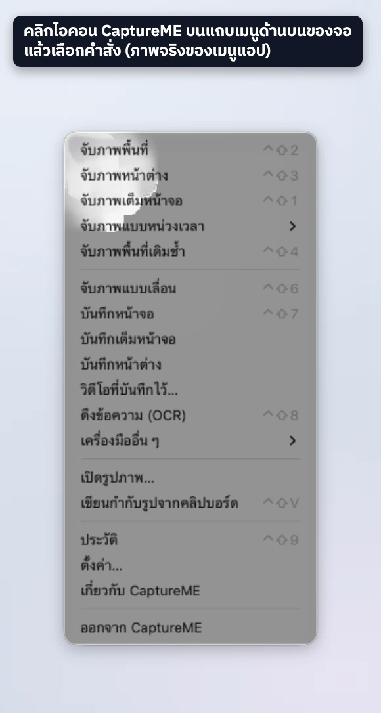

1. **คลิกไอคอนบนแถบเมนู** เพื่อเปิดเมนู – ทุกเครื่องมือมีอยู่ในนี้ (ตัวเลขทางขวาคือคีย์ลัด)
2. หรือ **กดคีย์ลัด** จากที่ไหนก็ได้ (ดู [หัวข้อ 13](#13-คีย์ลัดทั้งหมด))
3. ครั้งแรกจะมีหน้าต้อนรับให้อนุญาต **Screen Recording** → ดู [คู่มือติดตั้ง](INSTALL-TH.md)

---

## 2. จับภาพ
กดคีย์ลัดหรือเลือกจากเมนู หน้าจอจะ **แช่แข็ง** (เหมือนหยุดภาพ) แล้วมีเลเยอร์ให้เลือก กด **Esc** เพื่อยกเลิกได้ทุกโหมด

### 2.1 จับภาพพื้นที่ — `⌃⇧2`
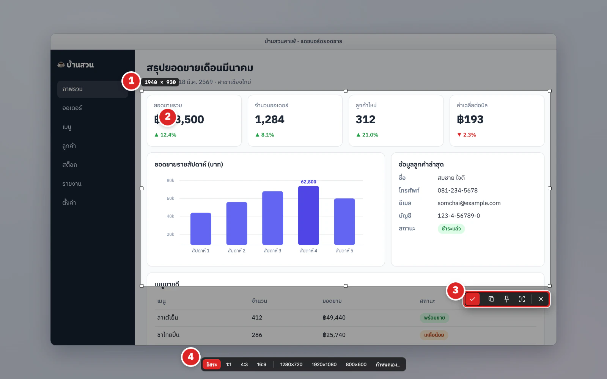

1. กด `⌃⇧2` แล้ว **ลากเมาส์** ครอบพื้นที่ที่ต้องการ (**①** ป้ายบอกขนาดเป็นพิกเซลของภาพที่จะได้)
2. ปรับกรอบ **②**: ลากมุม/ขอบ · `Space` + ลาก = ย้ายกรอบ · `Shift` = สี่เหลี่ยมจัตุรัส · ปุ่มลูกศร = ขยับทีละพิกเซล (`Shift` = 10 พิกเซล)
3. แถบเครื่องมือ **③**: **ยืนยัน** (`Enter` หรือดับเบิลคลิก) · **คัดลอก** (`⌘C`) · **ปักหมุด** · **OCR** · **ยกเลิก** (`Esc`)
4. ภาพจะถูกเก็บในประวัติ แล้วทำตามที่ตั้งไว้ใน *ตั้งค่า › ทั่วไป › การทำงานหลังจับภาพ* (ดู [2.6](#26-หลังจับภาพ-ภาพย่อมุมจอ))

### 2.2 เคล็ดลับตอนเลือกพื้นที่
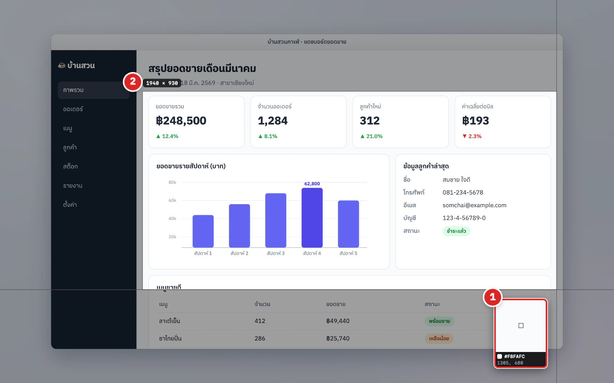

- **แว่นขยายพิกเซล ①** ติดตามเมาส์ แสดงพิกเซล 15×15 พร้อมรหัสสี (HEX) ใต้เมาส์ ช่วยให้ลากชิดขอบเป๊ะ ๆ · **②** ขนาดอัปเดตสด

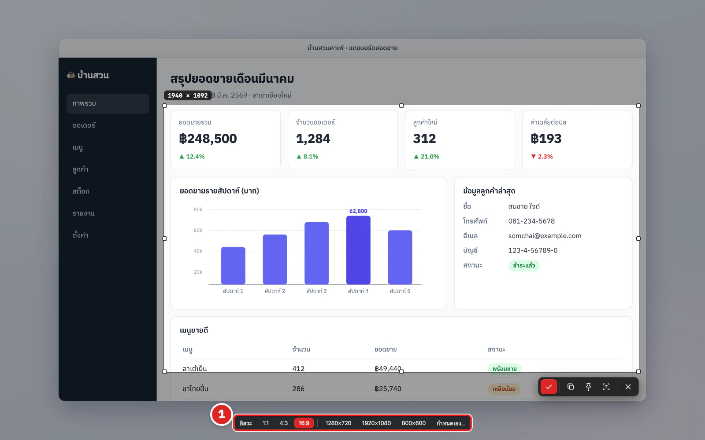

- **ขนาดสำเร็จรูป ①** (แถบล่างจอ): *อิสระ · 1:1 · 4:3 · 16:9 · 1280×720 · 1920×1080 · 800×600 · กำหนดเอง…* – ล็อกอัตราส่วนทั้งตอนลากและตอนปรับกรอบ (ภาพข้างบนเลือก 16:9) ส่วนขนาดตายตัวคือจำนวน **พิกเซล** ของภาพที่ได้ แค่คลิกเพื่อวางกรอบ

### 2.3 จับภาพหน้าต่าง — `⌃⇧3`
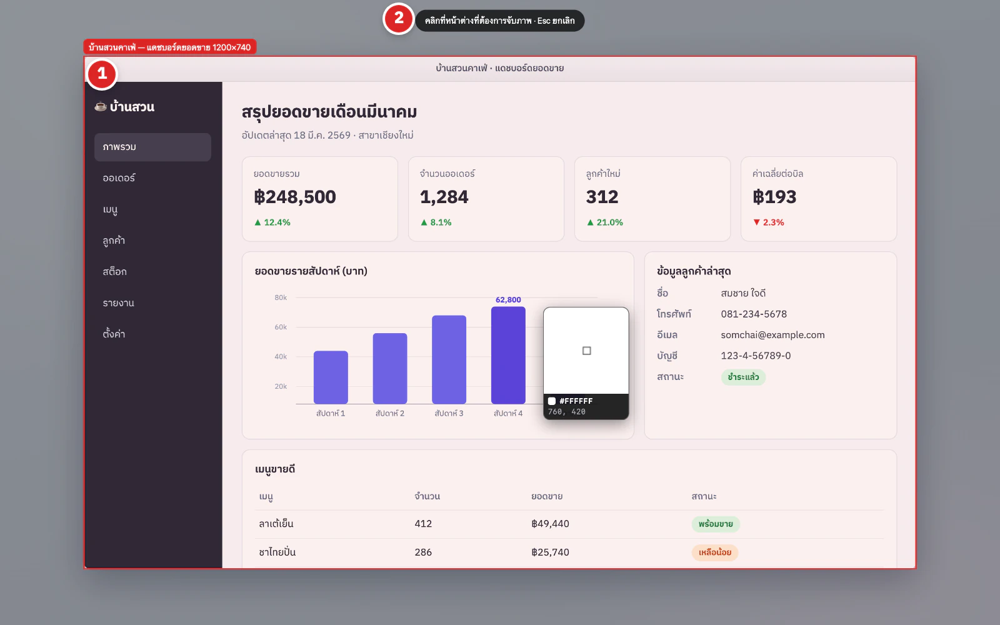

1. กด `⌃⇧3` แล้วเลื่อนเมาส์ไปบนหน้าต่าง จะมีกรอบแดงไฮไลต์พร้อมชื่อและขนาด **①**
2. **คลิก** เพื่อจับภาพเฉพาะหน้าต่างนั้น (แม้จะมีหน้าต่างอื่นบังอยู่บางส่วน)
3. เปิด *ตั้งค่า › ทั่วไป › จับภาพหน้าต่างพร้อมเงา* ถ้าต้องการเงาของหน้าต่างบนพื้นโปร่งใส

### 2.4 จับภาพเต็มหน้าจอ — `⌃⇧1`
กดแล้วจับทั้งจอทันที (ถ้ามีหลายจอ จะเป็นจอที่เมาส์อยู่) ไม่มีหน้าต่างเลือก

### 2.5 จับซ้ำพื้นที่เดิม — `⌃⇧4` · หน่วงเวลา — `⌃⇧5`
- **จับซ้ำพื้นที่เดิม** `⌃⇧4`: จับพื้นที่/หน้าต่างล่าสุดอีกครั้งจากหน้าจอจริง ไม่ต้องลากใหม่ (ถ้ายังไม่เคยจับ จะเปิดโหมดเลือกพื้นที่ให้)
- **หน่วงเวลา** `⌃⇧5`: สำหรับเมนูและ tooltip ที่หายไปเมื่อกดคีย์ลัด – นับถอยหลังกลางจอ (คีย์ลัดใช้ 5 วินาที; เลือก 3 / 5 / 10 วินาทีได้จากเมนูบนแถบเมนู › จับภาพแบบหน่วงเวลา) แล้วจึงเข้าโหมดเลือกพื้นที่

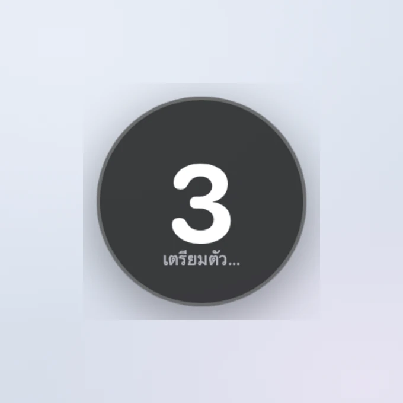

### 2.6 หลังจับภาพ: ภาพย่อมุมจอ
ที่ *ตั้งค่า › ทั่วไป › การทำงานหลังจับภาพ* เลือกได้ 4 แบบ: **เปิดตัวแก้ไขภาพ** (ค่าเริ่มต้น) · **แสดงภาพย่อมุมจอ** · **คัดลอกอย่างเดียว** · **บันทึกไฟล์อย่างเดียว**

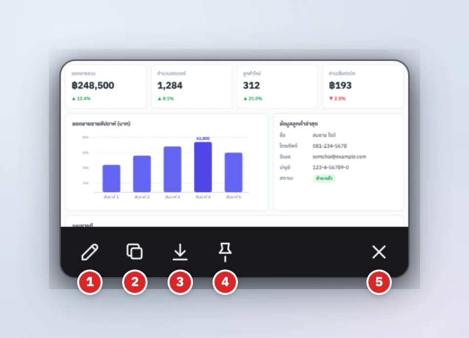

ภาพย่อลอยที่มุมขวาล่างของจอ มีปุ่ม **① แก้ไข · ② คัดลอก · ③ บันทึก · ④ ปักหมุด · ⑤ ปิด (`Esc`)** ภาพหายเองตามเวลาที่ตั้ง (0 = ค้างไว้ ไม่หายขณะเอาเมาส์ชี้) และ **ลากภาพออกไปวาง** ใน Finder / Mail / แชต ได้ทันที

---

## 3. ตัวแก้ไขภาพ – ทีละเครื่องมือ
เปิดอัตโนมัติหลังจับภาพ (หรือเปิดจากประวัติ / ภาพย่อ) · กด **`?`** เพื่อดูคีย์ลัดทั้งหมด · `⌘Z` เลิกทำ · `⇧⌘Z` ทำซ้ำ

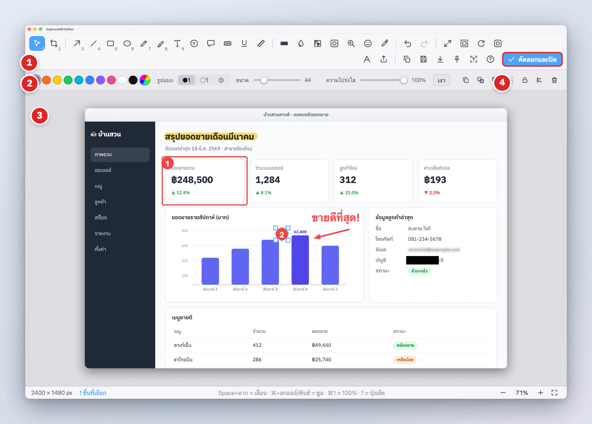

**① แถบเครื่องมือ** (เลือกด้วยปุ่มหรือกดตัวอักษร / เลข `1`–`9`) · **② แถบสไตล์** ของเครื่องมือที่เลือก (สี ความหนา ฯลฯ) · **③ ผืนภาพ** (`Space` + ลาก = เลื่อน · `⌘` + สกรอลล์ = ซูม) · **④ คัดลอกและปิด** `⌘↵`

คีย์เดียวเลือกเครื่องมือ: `V` เลือก/ย้าย · `C` ครอป · `A` ลูกศร · `L` เส้น · `R` สี่เหลี่ยม · `O` วงรี · `P` ปากกา · `H` ไฮไลต์ · `T` ข้อความ · `N` ตัวนับลำดับ · `Q` ฟองคำพูด · `Y` กล่องมาร์กเกอร์ · `U` ขีดเส้นใต้ · `Z` วัดระยะ · `D` ปิดทึบ · `B` เบลอ · `X` โมเสก · `S` สปอตไลต์ · `M` แว่นขยาย · `E` สติกเกอร์ · `I` ดูดสี

### 3.1 ลูกศร — `A`
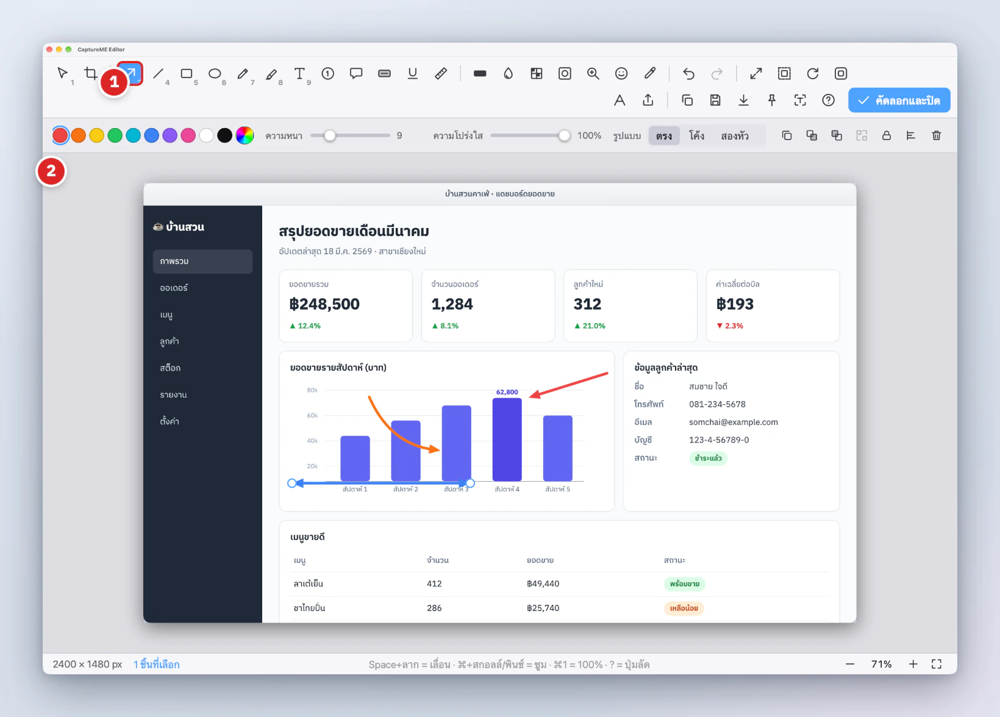
1. กด `A` (①) แล้ว **ลากจากจุดเริ่มไปยังจุดที่ต้องการชี้**
2. เลือกรูปแบบที่แถบสไตล์ (②): **ตรง / โค้ง / สองหัว / เรียว** · สี · ความหนา · เงา
3. `Shift` = ล็อกมุมทีละ 45°

### 3.2 เส้น · สี่เหลี่ยม · วงรี — `L` `R` `O`
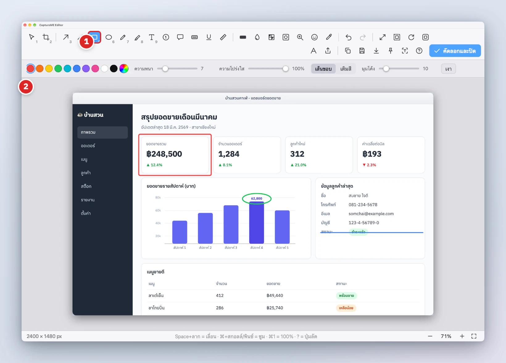
1. กด `R` (สี่เหลี่ยม) / `O` (วงรี) / `L` (เส้น) แล้ว **ลากวาด** · `Shift` = สัดส่วน/มุมตรง
2. แถบสไตล์: **เส้นขอบ / เติมสี** · มุมโค้ง · สี · ความหนา · ความโปร่งใส

### 3.3 ปากกา · ไฮไลต์ — `P` `H`
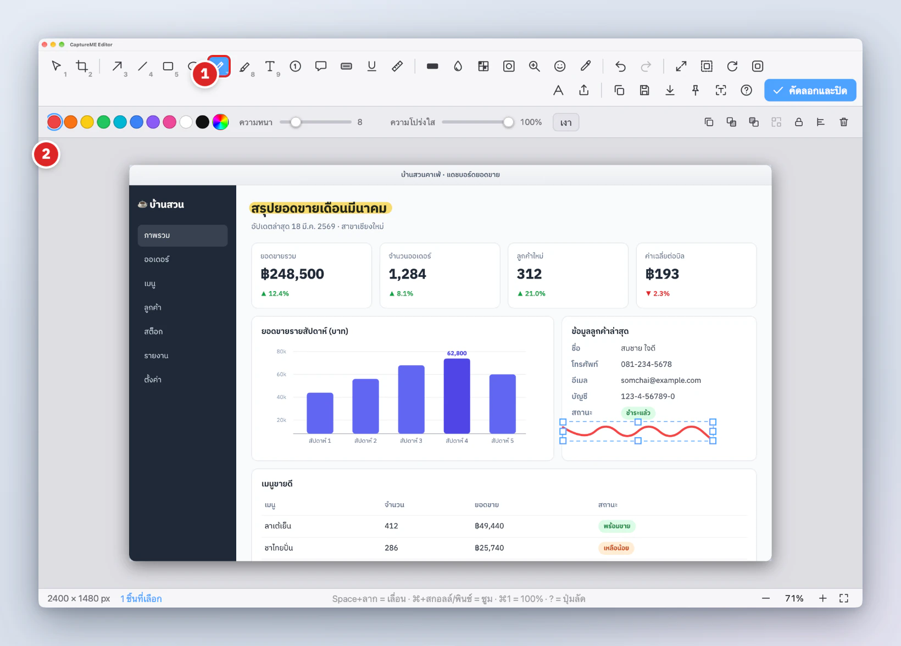
1. `P` = วาดอิสระ · `H` = ไฮไลต์สีโปร่งแสง (ลากทับข้อความเพื่อเน้น)
2. ปรับสี ความหนา ความโปร่งใสที่แถบสไตล์

### 3.4 ข้อความ — `T`
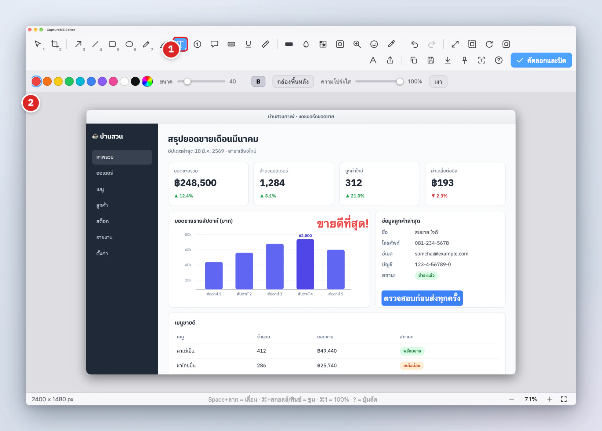
1. กด `T` แล้ว **คลิกที่ภาพ** → พิมพ์ได้ทั้งไทย/อังกฤษ
2. แถบสไตล์: **ขนาด · ตัวหนา · กล่องพื้นหลัง · สี · เงา**
3. จบการพิมพ์ด้วย `Esc` หรือ `⌘↵`

### 3.5 ตัวนับลำดับ — `N`
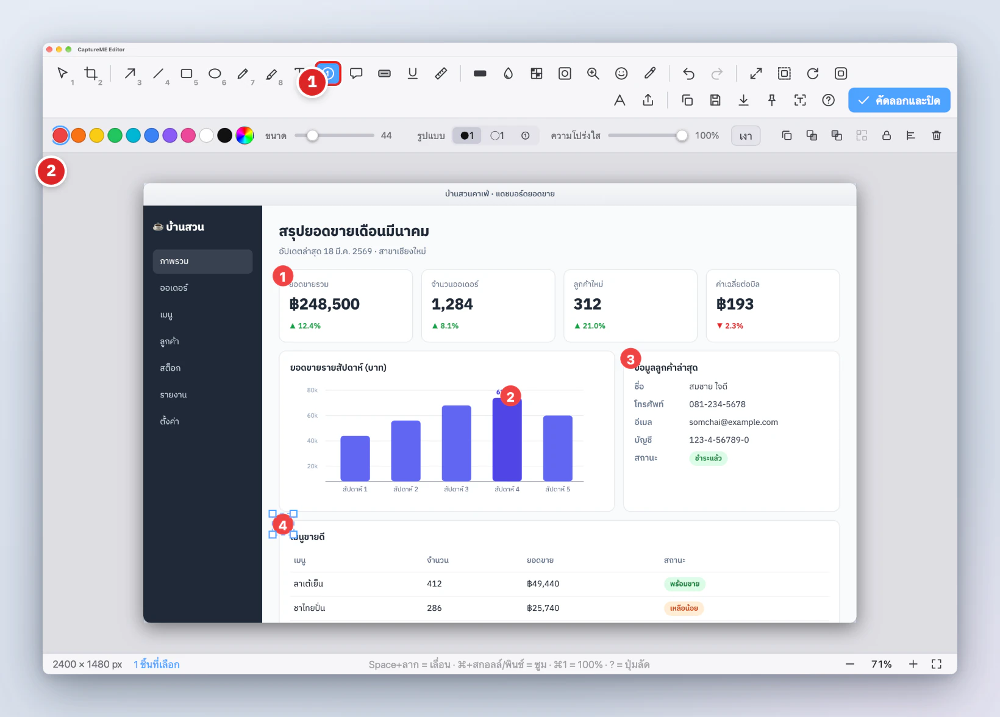
คลิกที่ภาพเพื่อวางเลข 1, 2, 3… ต่อเนื่องอัตโนมัติ เหมาะกับภาพอธิบายขั้นตอน · เลือกสไตล์ ●1 / ◯1 / ① ได้

### 3.6 ฟองคำพูด · กล่องมาร์กเกอร์ · ขีดเส้นใต้ — `Q` `Y` `U`
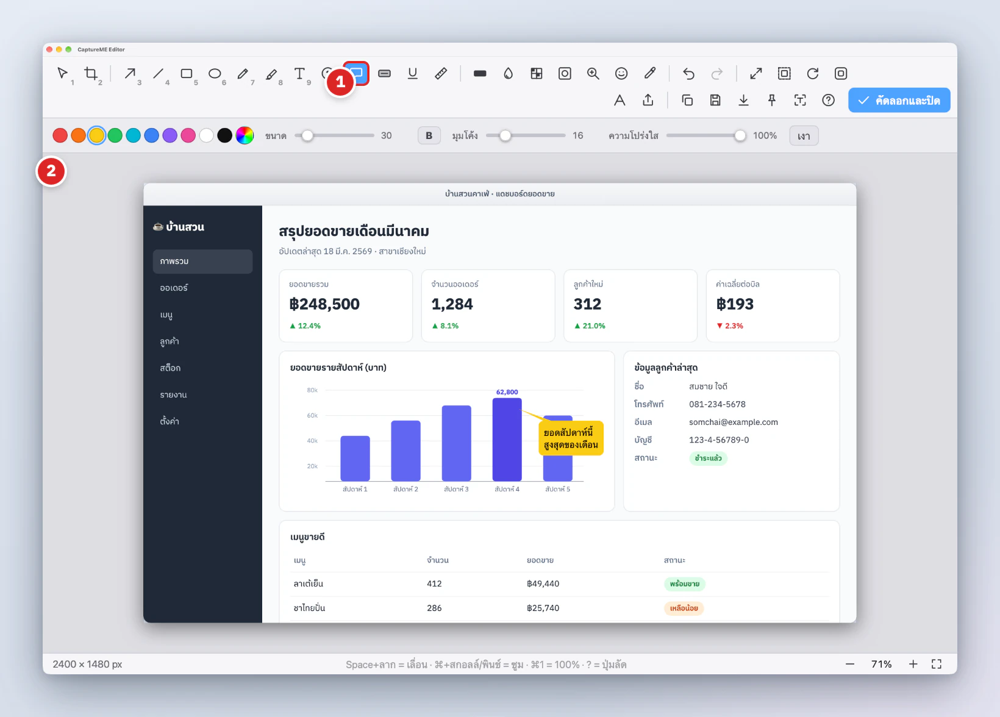
- `Q` ฟองคำพูดพร้อมหางชี้ (ดับเบิลคลิกเพื่อแก้ข้อความ) · `Y` กรอบมาร์กเกอร์ไฮไลต์ · `U` ขีดเส้นใต้ / ขีดฆ่า / ลอนคลื่น

### 3.7 ปิดทึบ · เบลอ · โมเสก — `D` `B` `X`
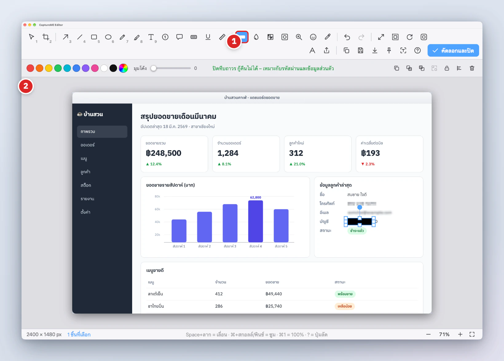
1. ลากทับข้อมูลที่ไม่อยากให้เห็น: โทรศัพท์ → **โมเสก** · อีเมล → **เบลอ** · เลขบัญชี → **ปิดทึบ** (ภาพนี้ใช้ครบทั้ง 3 แบบ)
2. ⚠️ **เบลอ/โมเสก** กับตัวอักษรเล็ก ๆ อาจถูกโปรแกรมกู้คืนได้ → สำหรับรหัสผ่าน เลขบัญชี ข้อมูลส่วนตัว ให้ใช้ **ปิดทึบ (Redact)** ซึ่งเป็นสีทึบ **กู้คืนไม่ได้** (แอปมีปุ่ม "เปลี่ยนเป็นปิดทึบ" ให้เมื่อเลือกเบลอ)

### 3.8 สปอตไลต์ — `S`
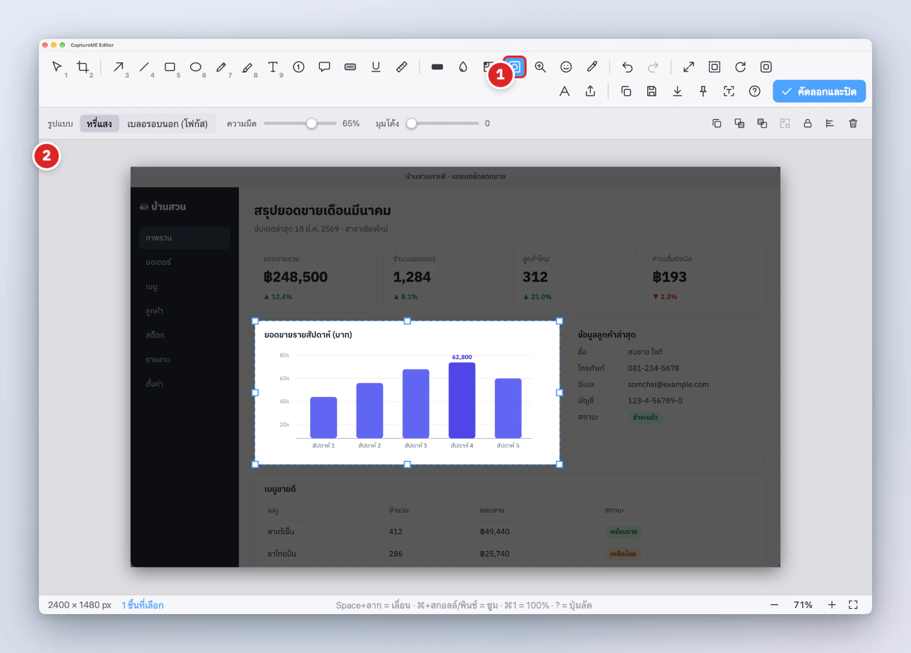
ลากกรอบรอบส่วนสำคัญ → ส่วนอื่นของภาพจะมืดลง (หรือเปลี่ยนเป็น **เบลอรอบนอก** ที่แถบสไตล์) ปรับความมืด/มุมโค้งได้

### 3.9 แว่นขยาย — `M`
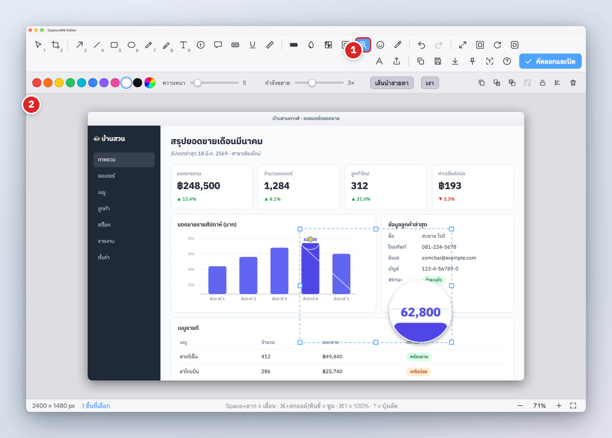
ลากวงแว่นขยายไปวางบริเวณว่าง เปิด **เส้นนำ** แล้วลากจุดสีเหลืองไปยังบริเวณที่ต้องการขยาย (ขยาย 1.5×–6×)

### 3.10 วัดระยะ — `Z`
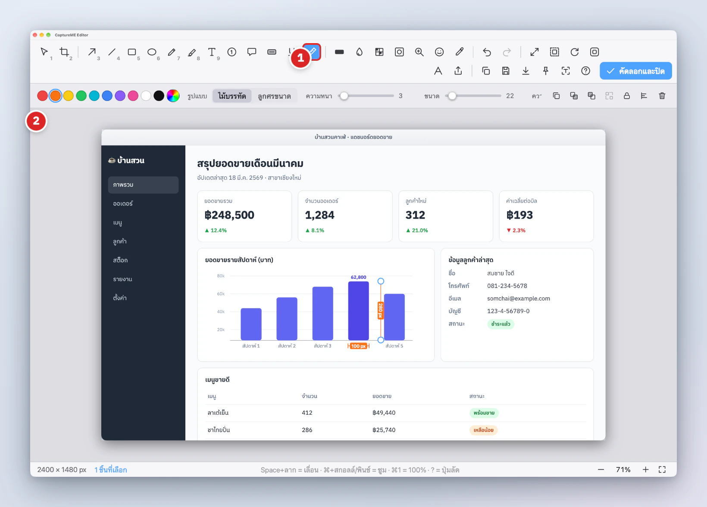
ลากเส้นวัดบนภาพ – เลือกแบบ **ไม้บรรทัด** หรือ **ลูกศรบอกขนาด (dimension)** ตัวเลขแสดงเป็นพิกเซลของภาพ

### 3.11 ครอป — `C`
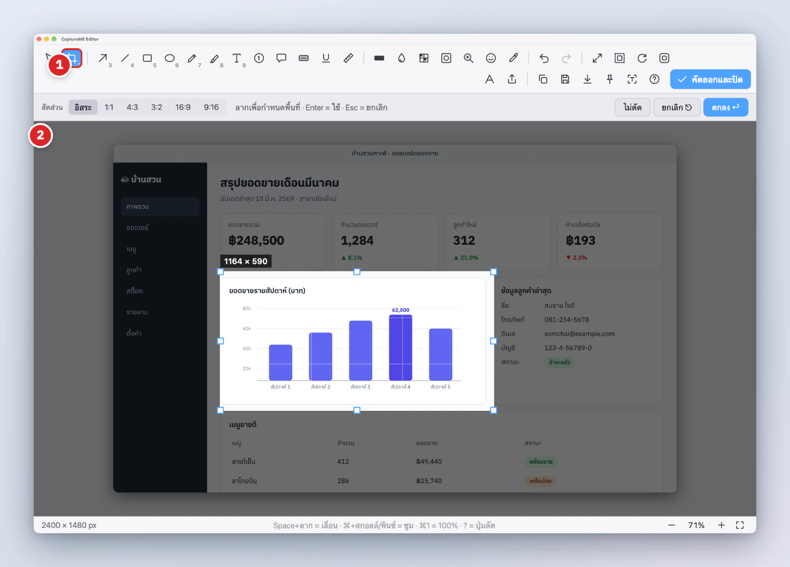
1. กด `C` แล้ว **ลากกรอบ** (เลือกอัตราส่วน: อิสระ · 1:1 · 4:3 · 3:2 · 16:9 · 9:16)
2. `Enter` = ใช้ · `Esc` = ยกเลิก · ปุ่ม *รีเซ็ต* คืนกรอบ

### 3.12 พื้นหลังตกแต่ง (Beautifier)
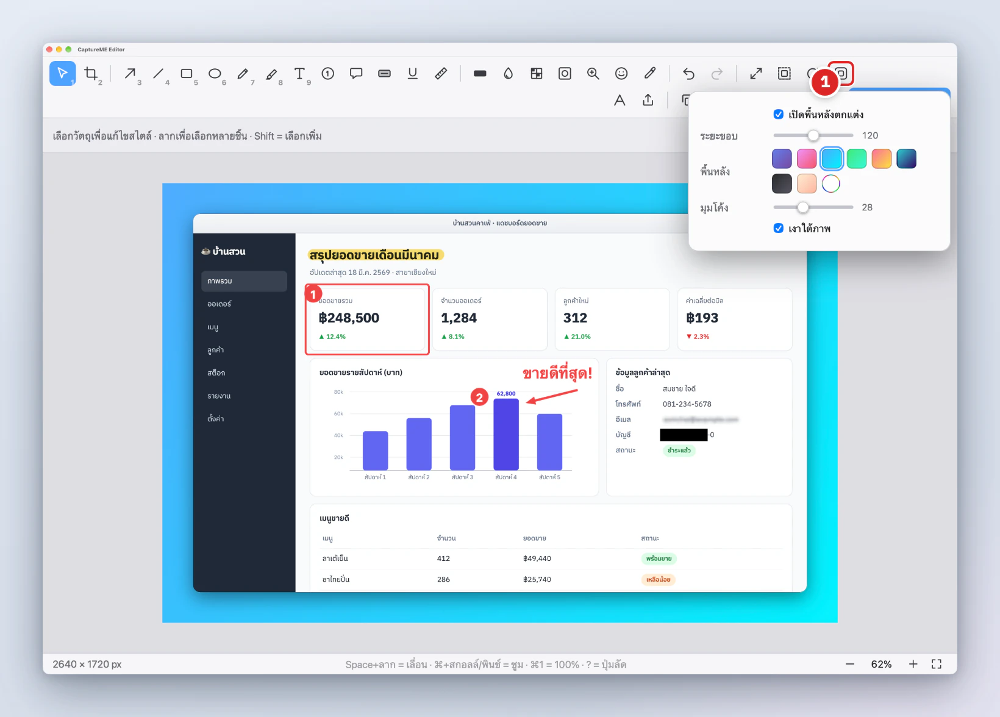
คลิกปุ่มพื้นหลังที่แถบบน (①) → เปิด **เปิดพื้นหลังตกแต่ง** → เลือกสีไล่ระดับ/สีทึบ · ปรับ **ระยะขอบ · มุมโค้ง · เงา** ให้ภาพสวยพร้อมโพสต์ (ภาพนี้ใช้ระยะขอบ 120, มุมโค้ง 28)

### 3.13 ลายน้ำ
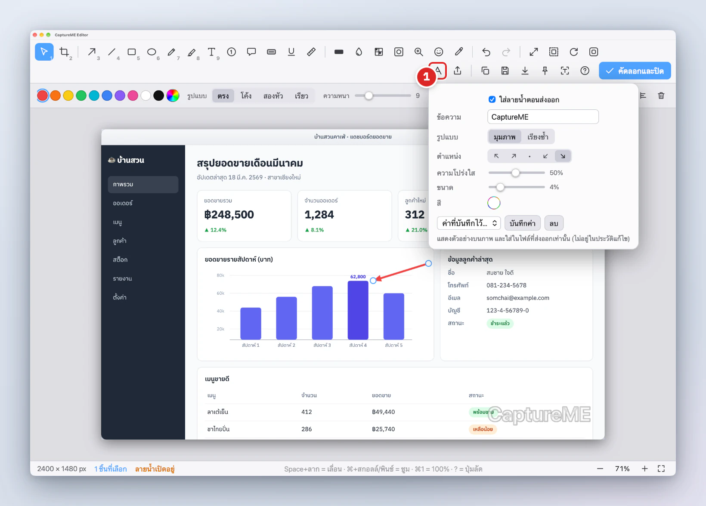
ปุ่มลายน้ำ (①) → ใส่ข้อความ เลือกตำแหน่งมุมหรือเรียงซ้ำ ความโปร่งใส ขนาด มุมเอียง สี · **บันทึกค่า** เป็นค่าสำเร็จรูป · ลายน้ำจะถูกใส่ **ตอนส่งออกเท่านั้น** (เปิดช่อง *ใส่ลายน้ำตอนส่งออก*)

### 3.14 เพิ่มขอบ · ปรับขนาด · หมุน/พลิก
| | |
|---|---|
| 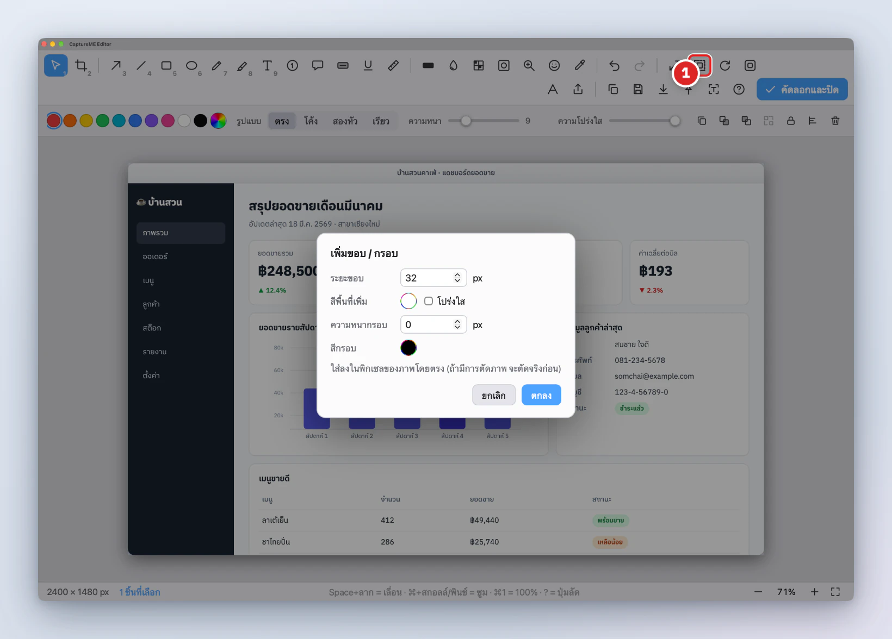 | **เพิ่มขอบ / กรอบ** – ระยะขอบ สีพื้น (หรือโปร่งใส) ความหนา/สีของกรอบ ใส่ลงในพิกเซลของภาพจริง |
| 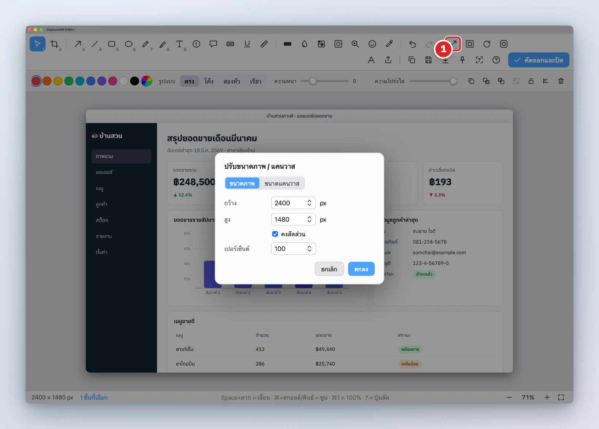 | **ปรับขนาดภาพ / แคนวาส** – เปลี่ยนความละเอียด (ล็อกสัดส่วนได้) หรือขยายแคนวาส |
| 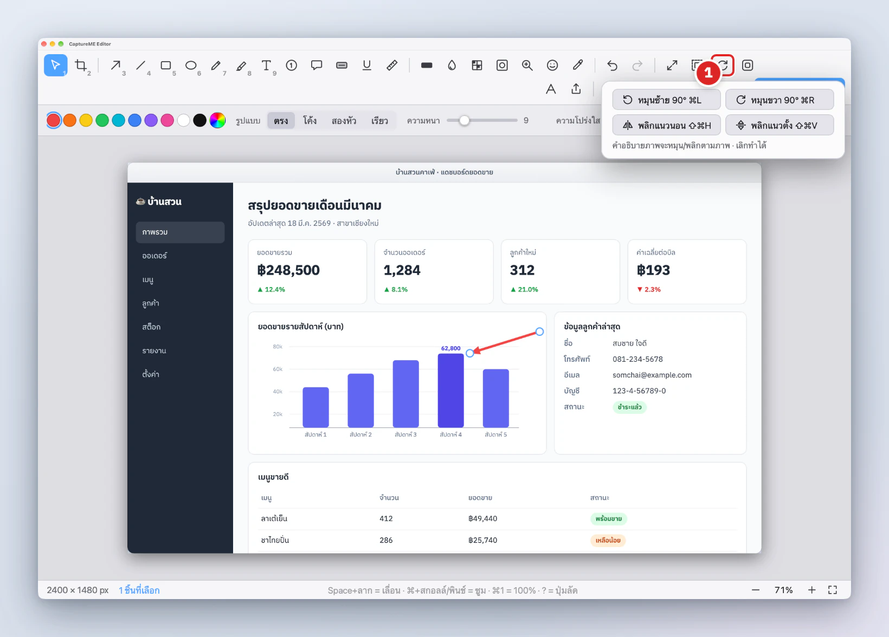 | **หมุน / พลิก** – หมุนซ้าย/ขวา 90° (`⌘L` / `⌘R`) พลิกแนวนอน/แนวตั้ง (`⇧⌘H` / `⇧⌘V`) วัตถุที่วาดไว้หมุนตามภาพ |

### 3.15 แทรกรูปภาพ
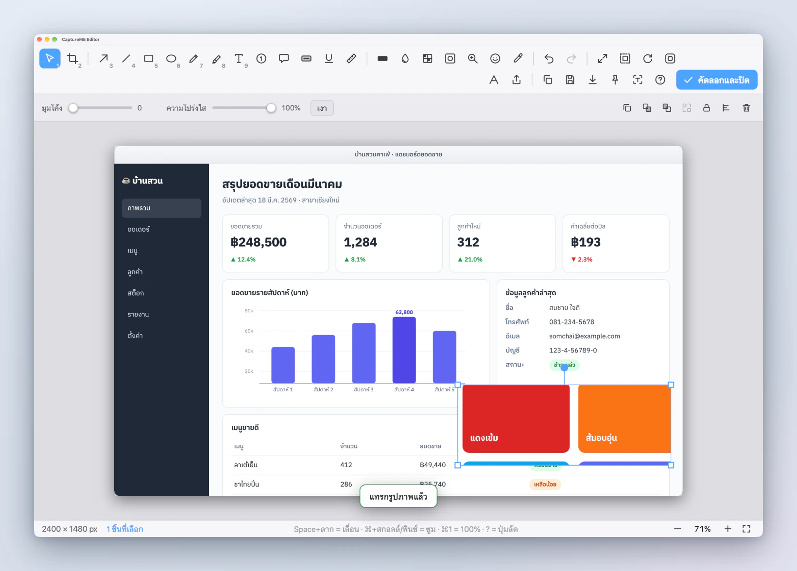
กด `⌘V` วางรูปจากคลิปบอร์ด หรือ **ลากไฟล์รูปมาวาง** บนภาพ – รูปที่แทรกย้าย/ย่อขยาย/หมุนได้เหมือนวัตถุอื่น (ตัวอย่างวางรูปชุดสีลงบนภาพ)

### 3.16 จัดวาง · จัดกลุ่ม · ล็อก
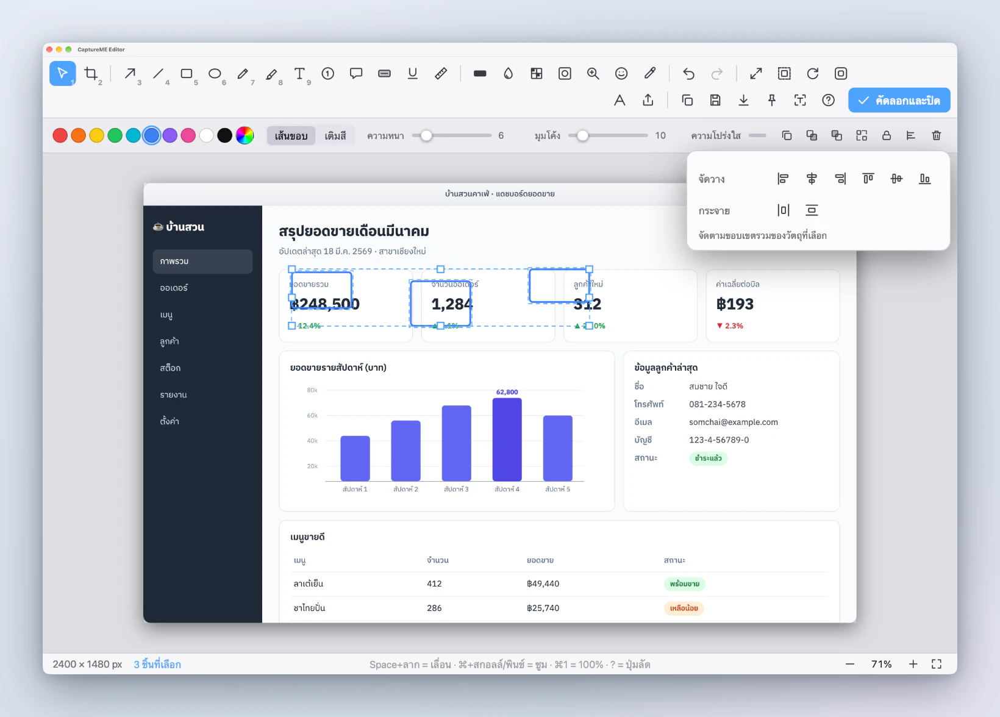
1. ใช้ `V` เลือกหลายชิ้น (ลากกรอบ / `Shift`+คลิก) → ปุ่ม **จัดวาง** ที่ด้านขวาของแถบสไตล์: ชิดซ้าย/กลาง/ขวา/บน/กลาง/ล่าง และ **กระจายเท่ากัน**
2. `⌘G` จัดกลุ่ม · `⇧⌘G` แยกกลุ่ม · `⇧⌘L` ล็อก · `⌘D` ทำสำเนา (หรือลากพร้อม `⌥`) · `⌘]` / `⌘[` นำมาหน้า/ส่งไปหลัง · `Delete` ลบ

### 3.17 ส่งออก: คัดลอก · บันทึก · ปักหมุด · OCR

- **คัดลอก** `⌘C` · **บันทึก** `⌘S` · **บันทึกเป็น…** `⇧⌘S` · **คัดลอกแล้วปิด** `⌘↵` · ปุ่ม **ปักหมุด** และ **OCR** อยู่ในแถบเดียวกัน
- เมนูส่งออก (①): **สเกล 50% / 100% / 200%** · บันทึกเป็น JPEG · คัดลอกที่อยู่ไฟล์ · แสดงใน Finder
- `⌘W` ปิด – ถ้ามีการแก้ไขที่ยังไม่บันทึก จะถามก่อน · ฉบับที่แก้ไขถูกเก็บในประวัติให้อัตโนมัติ

### 3.18 หน้าช่วยเหลือ – คีย์ลัดทั้งหมด (`?`)
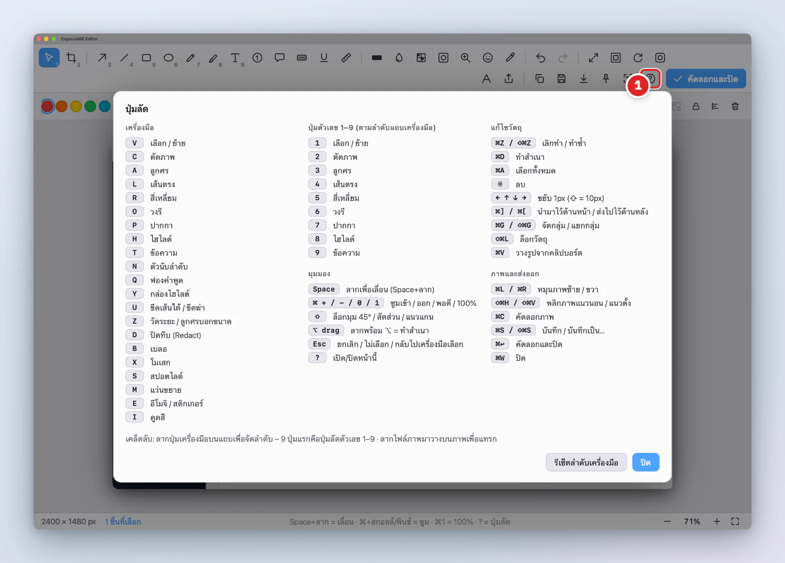
กด `?` เพื่อเปิดสรุปคีย์ลัด · ลากปุ่มเครื่องมือบนแถบเพื่อ **เรียงลำดับใหม่** (9 ปุ่มแรกคือปุ่มเลข `1`–`9`) · รีเซ็ตลำดับได้ในหน้านี้

---

## 4. ปักหมุดภาพ (Pin)
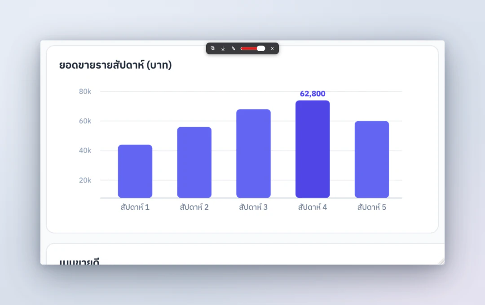
วางภาพ **ลอยอยู่เหนือหน้าต่างทั้งหมด** เหมาะกับดูภาพอ้างอิงระหว่างทำงาน (ภาพนี้คือหน้าต่างปักหมุดจริง วางลอยบนหน้าจอ)
1. กด `⌃⇧P` แล้วลากเลือกพื้นที่ (หรือกดปุ่ม **ปักหมุด** จากแถบตอนเลือกพื้นที่ / ตัวแก้ไข / ภาพย่อ / ประวัติ)
2. **ย้าย:** ลากที่ภาพ · **ปรับความโปร่งใส:** `⌥` + สกรอลล์ · **ปิด:** `Esc`
3. ปุ่มบนภาพ (วางเมาส์เหนือภาพ): **คัดลอก · บันทึก · แก้ไข · ปิด**

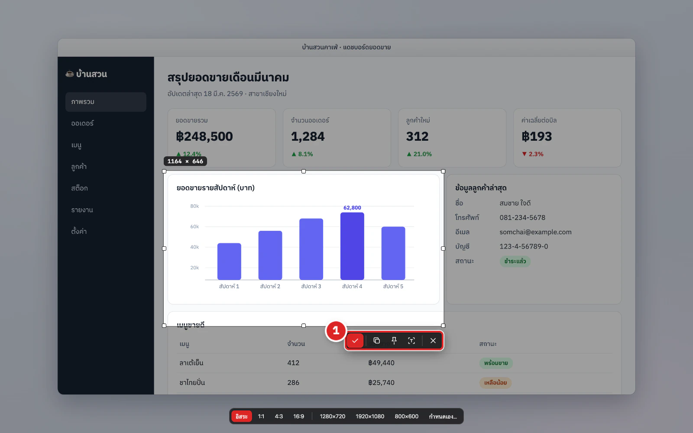

---

## 5. OCR – อ่านข้อความจากภาพ
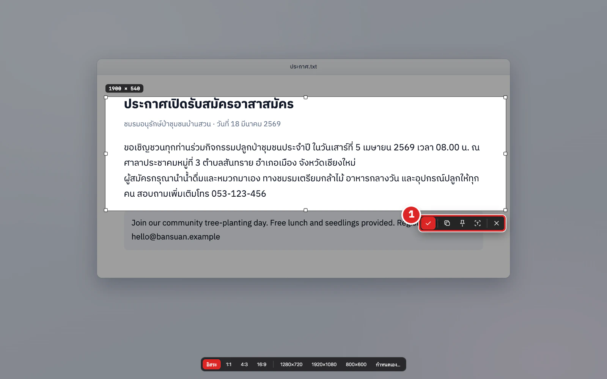
1. กด **`⌃⇧8`** แล้วลากเลือกพื้นที่ที่มีตัวอักษร → กด **ยืนยัน**
2. ข้อความที่อ่านได้ (**ไทย + อังกฤษ**) ขึ้นที่มุมขวาบนของจอ และถูก **คัดลอกให้อัตโนมัติ** แล้ว

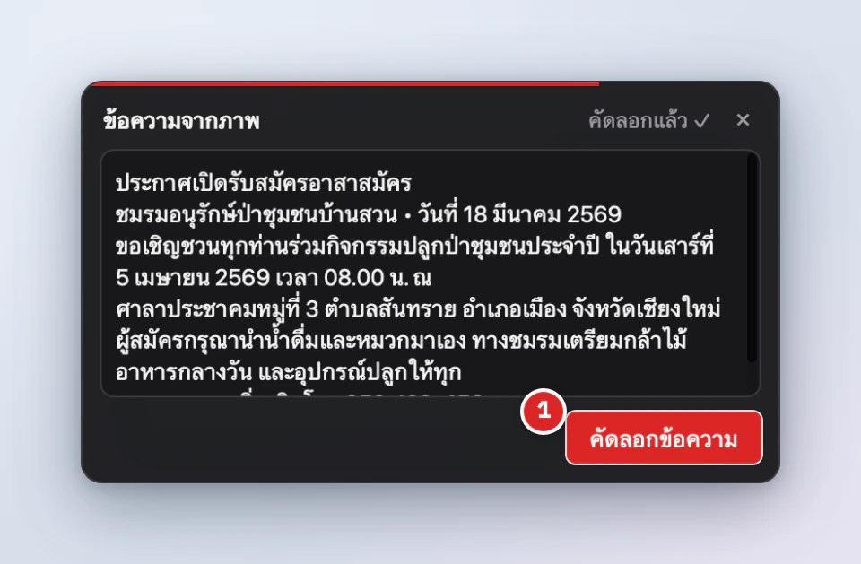

3. กด **① คัดลอกข้อความ** อีกครั้งเมื่อต้องการ · ✕ เพื่อปิด
- ประมวลผลบนเครื่องด้วย Apple Vision ไม่ส่งออกอินเทอร์เน็ต · ใช้จากตัวแก้ไข (ปุ่ม OCR) และแถบตอนเลือกพื้นที่ได้
- เคล็ดลับ: เลือกเฉพาะบล็อกข้อความ ภาพคมชัด ตัวไม่เล็กเกินไป · ภาษาไทยต้องใช้ macOS 14 ขึ้นไป

---

## 6. อ่าน QR · ดูดสี · ไม้บรรทัดพิกเซล
ทั้งสามทำงานบน "ภาพนิ่งของหน้าจอ ณ ตอนที่เริ่มใช้" และออกด้วย `Esc`

### 6.1 อ่าน QR / บาร์โค้ด — `⌃⇧Q`
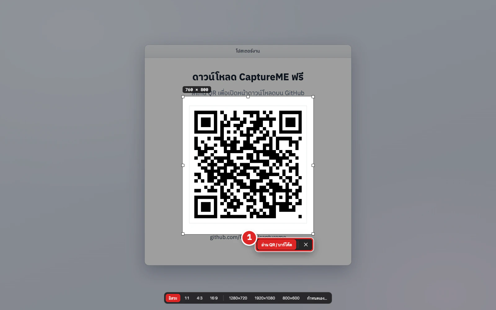
1. กด `⌃⇧Q` แล้วลากเลือกพื้นที่ที่มี QR หรือบาร์โค้ด (เผื่อขอบขาวรอบ ๆ เล็กน้อย) → **อ่าน QR / บาร์โค้ด**

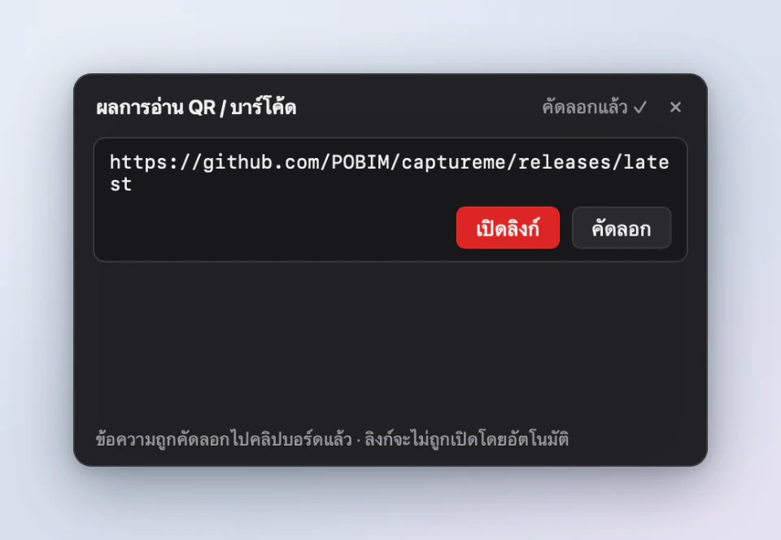

2. ข้อความถูก **คัดลอกให้อัตโนมัติ** · ถ้าเป็นลิงก์ มีปุ่ม **เปิดลิงก์** ซึ่ง *ถามยืนยันก่อนทุกครั้ง* (ลิงก์จะไม่ถูกเปิดเอง)

### 6.2 ดูดสีจากหน้าจอ — `⌃⇧C`
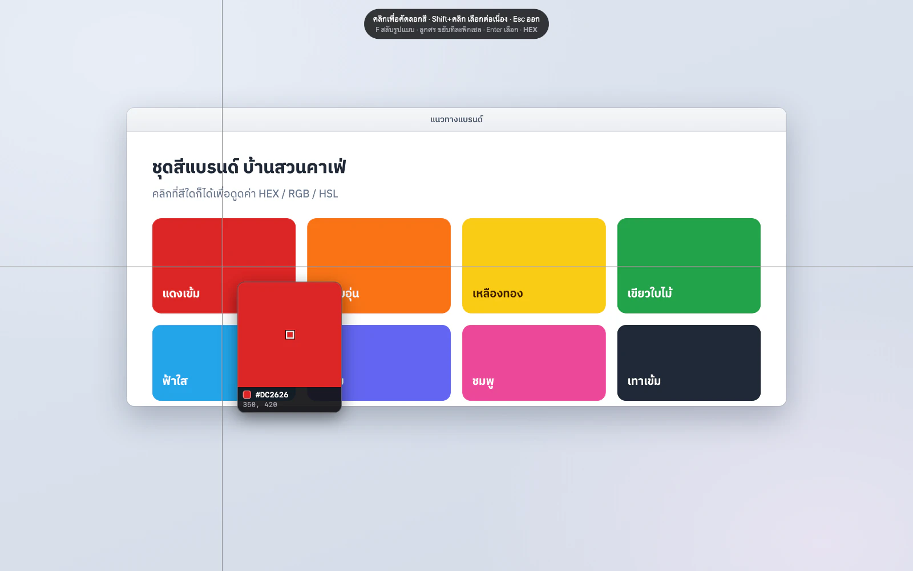
1. กด `⌃⇧C` แล้วเลื่อนเมาส์ไปบนสีที่ต้องการ – แว่นขยาย **①** แสดงรหัสสีใต้เมาส์
2. **คลิก** เพื่อคัดลอกสี (HEX / RGB / HSL ตามตั้งค่า · กด `F` เพื่อสลับรูปแบบ) · `Shift`+คลิก = เลือกต่อเนื่องหลายสี · ลูกศรขยับทีละพิกเซล

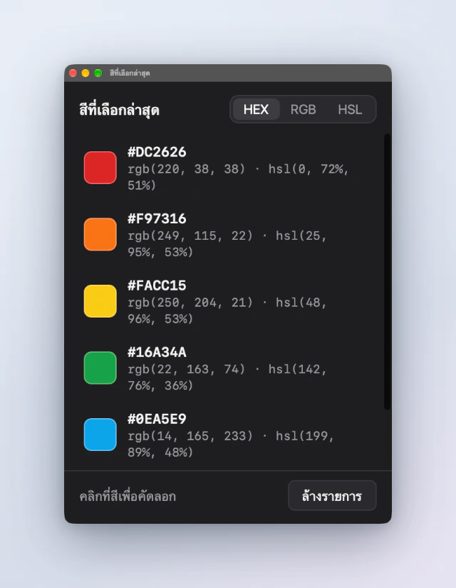

3. หน้าต่าง **สีที่เลือกล่าสุด** (เก็บ 30 สี) คลิกที่สีเพื่อคัดลอกซ้ำ · เปิดได้จากเมนู › เครื่องมืออื่น ๆ › สีที่เลือกล่าสุด…

### 6.3 ไม้บรรทัดพิกเซล — `⌃⇧M`
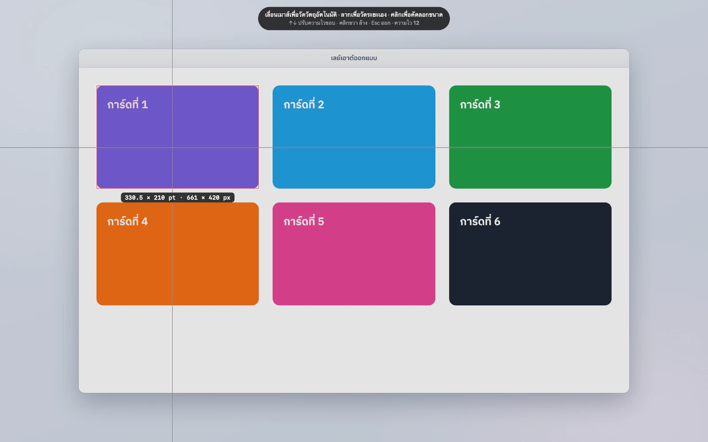
**เลื่อนเมาส์** = ตรวจหาขอบวัตถุอัตโนมัติและแสดง กว้าง × สูง (หน่วย pt และ px) · `↑`/`↓` ปรับความไวของขอบ · **ลาก** = วัดระยะเอง (รวมแนวทแยง) · **คลิก** = คัดลอก `W × H` · คลิกขวา = ล้าง

---

## 7. เขียนกำกับรูปจากคลิปบอร์ด / เปิดไฟล์รูป
- **`⌃⇧V`** – นำรูปที่คัดลอกไว้ในคลิปบอร์ดมาเปิดในตัวแก้ไข (บันทึกลงประวัติเป็น PNG; ไฟล์ต้นฉบับไม่ถูกแก้)
- **เมนู › เปิดรูปภาพ…** หรือ **ลากไฟล์รูปไปวางบนหน้าต่างตัวแก้ไข** – รองรับ PNG / JPG / WebP / GIF / HEIC / TIFF / BMP

---

## 8. สกรอลล์จับภาพ
ต่อภาพหน้าเว็บ/เอกสาร/แชตที่ยาวให้เป็นภาพเดียว (สูงสุด 30,000 พิกเซล)

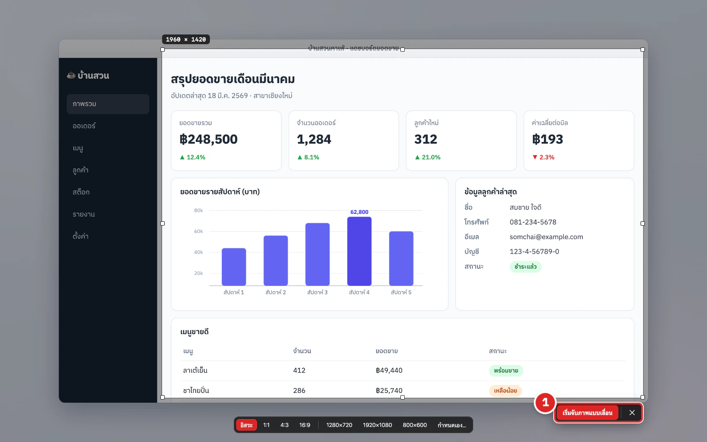

1. กด **`⌃⇧6`** แล้วลากเลือกพื้นที่ที่มีเนื้อหาให้เลื่อน → กด **เริ่มเลื่อนจับภาพ (①)**

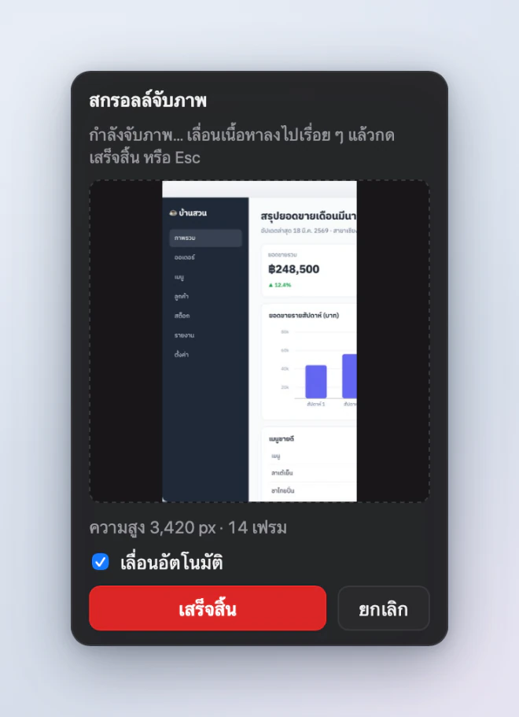

2. จะมีกรอบประสีน้ำเงินรอบพื้นที่ และหน้าต่างควบคุมนี้พร้อมภาพตัวอย่างสด (ความสูง / จำนวนเฟรม)
3. **เลื่อนเนื้อหา** ด้วยเมาส์/แทร็กแพดช้า ๆ สม่ำเสมอ (แอปข้ามส่วนหัว/ท้ายที่ตรึงให้เอง) – หรือเปิด **เลื่อนอัตโนมัติ** ให้แอปเลื่อนให้ (ต้องอนุญาต **Accessibility** และวางเมาส์ไว้บนเนื้อหา)
4. กด **เสร็จสิ้น** หรือ `Esc` → ภาพที่ต่อแล้วเปิดในตัวแก้ไขและถูกบันทึกในประวัติ
- เคล็ดลับ: หลีกเลี่ยงเนื้อหาที่เคลื่อนไหว/รีเฟรชเอง · ถ้าเห็นรอยต่อ ให้เลื่อนช้าลง
- *ภาพหน้าต่างควบคุมด้านบนเป็นหน้าต่างจริงของแอป แต่ตัวอย่างความสูง 3,420 px เป็นค่าสาธิต (เราไม่ได้เลื่อนหน้าจอจริงตอนถ่ายภาพ)*

---

## 9. บันทึกหน้าจอ และหน้าต่างวิดีโอ
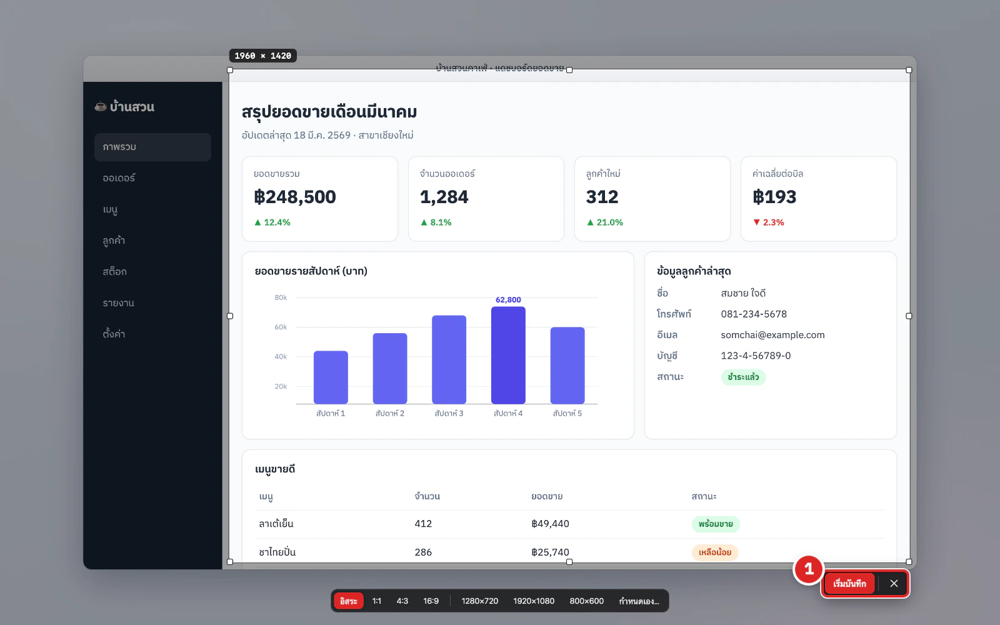

1. กด **`⌃⇧7`** แล้วเลือก **พื้นที่** (ลากเลือก) · **หน้าต่าง** (คลิก) · หรือ **ทั้งหน้าจอ** (เมนู › บันทึกเต็มหน้าจอ) → กด **เริ่มบันทึก**

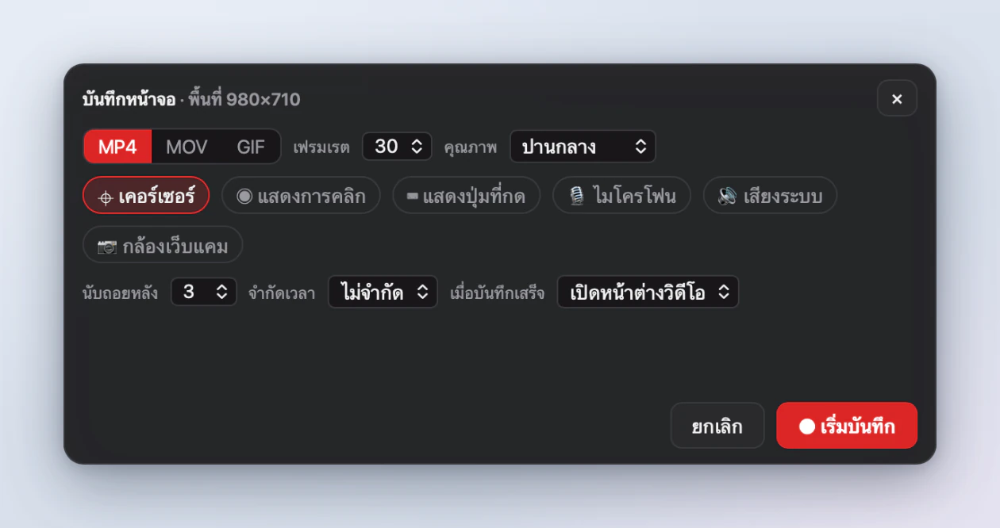

2. แถบตัวเลือก: รูปแบบ **MP4 / MOV / GIF** · เฟรมเรต · คุณภาพ · **เคอร์เซอร์** · **แสดงการคลิก** (วงสีที่จุดคลิก) · **แสดงปุ่มที่กด** · **ไมโครโฟน** · **เสียงระบบ** · **กล้องเว็บแคม** (วงกล้องลอยในวิดีโอ ลากย้ายได้ วงกลม/สี่เหลี่ยมมน) · นับถอยหลัง · จำกัดเวลา · สิ่งที่ทำเมื่อเสร็จ → **เริ่มบันทึก**
   - *ภาพนี้ไม่ได้เปิดเว็บแคมเพื่อความเป็นส่วนตัว – ตัวเลือกกล้อง/ไมค์จะขอสิทธิ์จาก macOS เมื่อเปิดใช้ครั้งแรก*

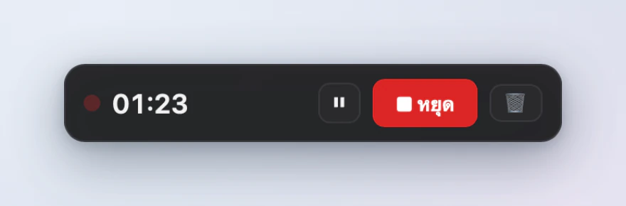

3. ระหว่างบันทึกมีกรอบแดงรอบพื้นที่ (ไม่ติดไปในวิดีโอ) และแถบนี้: เวลา · **พัก/บันทึกต่อ** (`Space`) · **หยุด** (หรือ `⌃⇧7` อีกครั้ง) · 🗑 ทิ้งการบันทึก
4. ไฟล์เก็บที่ `<โฟลเดอร์ปลายทาง>/Recordings` (ค่าเริ่มต้น `~/Pictures/CaptureME/Recordings`)
- บันทึก *หน้าต่าง* ไม่รวมวงคลิก/ปุ่มที่กด/เว็บแคม · GIF ไม่มีเสียง เคอร์เซอร์ หรือกล้อง
- ไม่มีไมค์/กล้อง หรือไม่อนุญาต → บันทึกต่อโดยไม่มีสิ่งนั้น (ดู [PRIVACY.md](../PRIVACY.md))

### หน้าต่างวิดีโอ: ตัดต้น-ท้าย · ส่งออก MP4 / GIF
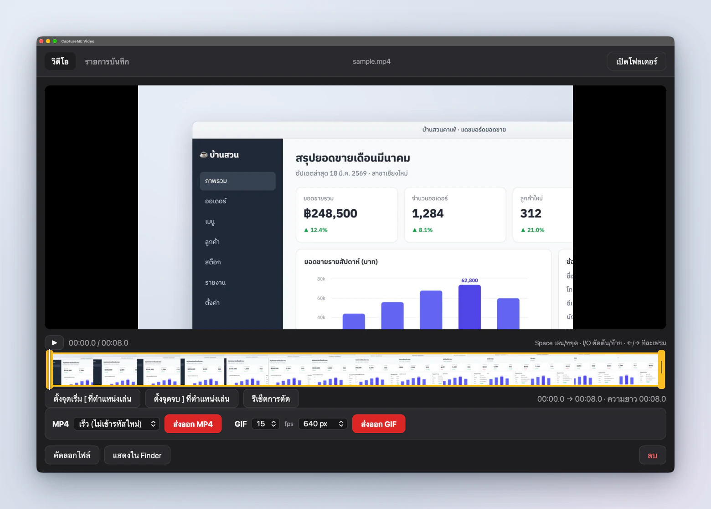
เปิดอัตโนมัติเมื่อบันทึกเสร็จ (ตั้งได้) มี 2 แท็บ: **วิดีโอ** และ **รายการบันทึก**
1. เล่น/หยุด `Space` · **ตัดต้น `I` / ตัดท้าย `O`** · ทีละเฟรม `←` `→` · รีเซ็ตการตัด
2. **ลบเสียงออก** · **ส่งออก MP4** (เร็ว = ไม่เข้ารหัสใหม่ / แม่นยำ = เข้ารหัสใหม่) · **ส่งออก GIF** (ขนาดเดิมหรือย่อ)
3. **คัดลอกไฟล์** (วางใน Finder/แชตได้) · แสดงใน Finder · ย้ายไปถังขยะ

---

## 10. ประวัติ — `⌃⇧9`
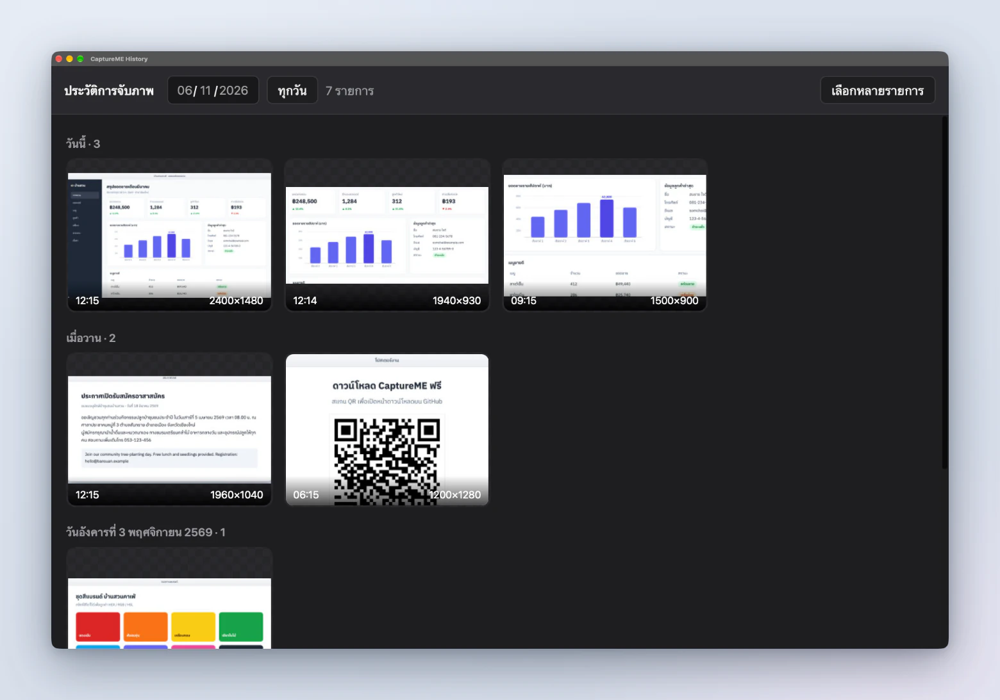
- ภาพทั้งหมดที่จับ เรียงตามวัน (วันนี้ / เมื่อวาน / …) มีป้าย **แก้ไขแล้ว** สำหรับภาพที่แก้ไข · กรองตามวันที่ด้วยรายการด้านบน
- ต่อภาพ: **เปิดในตัวแก้ไข · คัดลอก · แสดงใน Finder · ปักหมุด · ลบ**
- **เลือกหลายรายการ** → เลือกทั้งหมด/ทั้งวัน → ลบที่เลือก
- จำนวนสูงสุด (ค่าเริ่มต้น 200 – ใหม่ล่าสุดไว้ก่อน) และ **ล้างประวัติทั้งหมด** อยู่ที่ *ตั้งค่า › ประวัติ*

---

## 11. ตั้งค่า
เมนูแถบเมนู › **ตั้งค่า…** (หน้าต่างตัวอย่างด้านล่างเป็นภาษาไทย · สลับเป็น English ได้ที่แท็บทั่วไป)

### ทั่วไป – ภาษา · การทำงานหลังจับภาพ
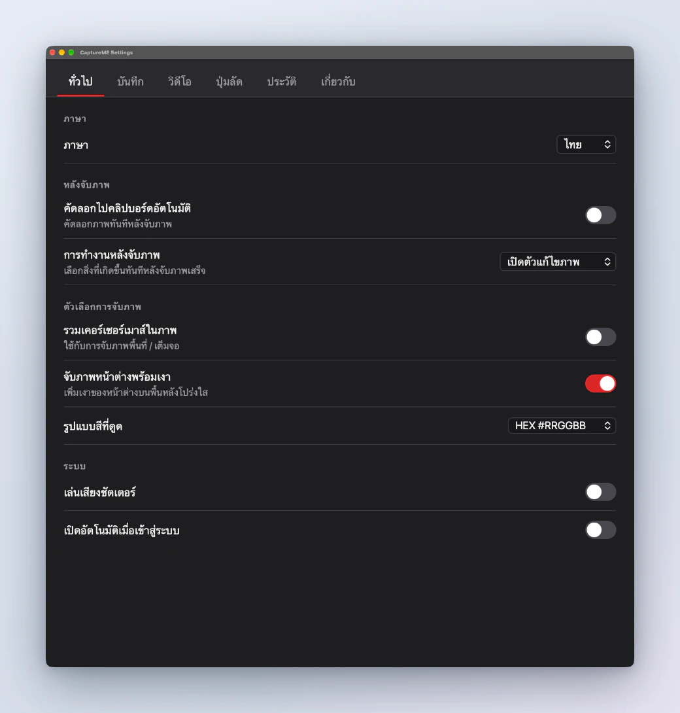
ภาษา (ไทย/English) · การทำงานหลังจับภาพ + เวลาที่ภาพย่อหายเอง · คัดลอกไปคลิปบอร์ดอัตโนมัติ · รวมเคอร์เซอร์ · จับหน้าต่างพร้อมเงา · รูปแบบสีที่ดูด · เสียงชัตเตอร์ · เปิดอัตโนมัติเมื่อเข้าสู่ระบบ

### บันทึก – โฟลเดอร์ปลายทางและชื่อไฟล์
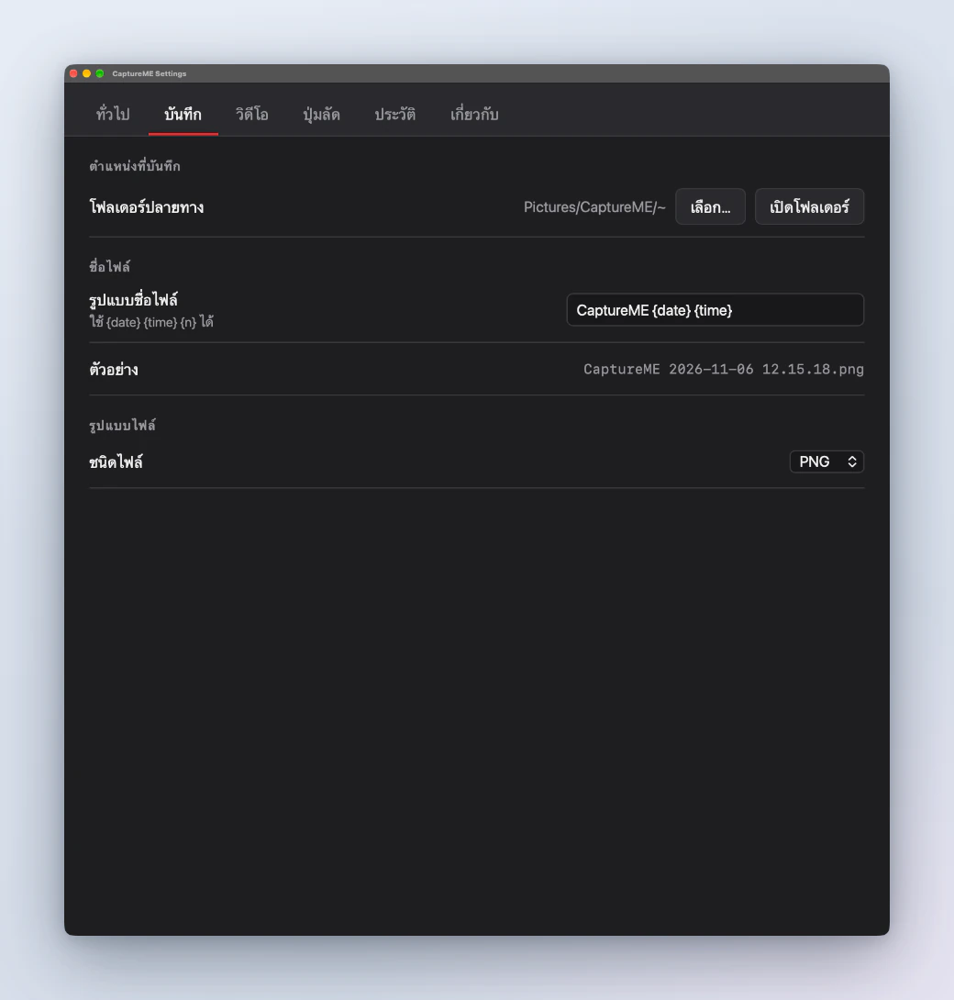
โฟลเดอร์ปลายทาง · รูปแบบชื่อไฟล์ (`{date}` `{time}` `{n}`) พร้อมตัวอย่าง · ชนิดไฟล์ PNG / JPG / WebP · คุณภาพ JPG

### ปุ่มลัด – ตั้งคีย์ลัดเอง
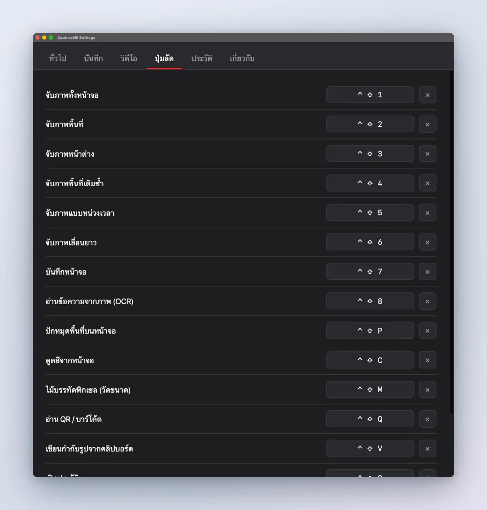
1. คลิกช่องของการทำงานที่ต้องการ แล้ว **กดคีย์ลัดใหม่** (ต้องมี ⌘ ⌃ หรือ ⌥) · `Esc` ยกเลิก
2. ปุ่ม **✕** = ปิดคีย์ลัดนั้น · ปุ่มคืนค่าเริ่มต้นอยู่ท้ายรายการ

### วิดีโอ · ประวัติ · เกี่ยวกับ
| | |
|---|---|
| 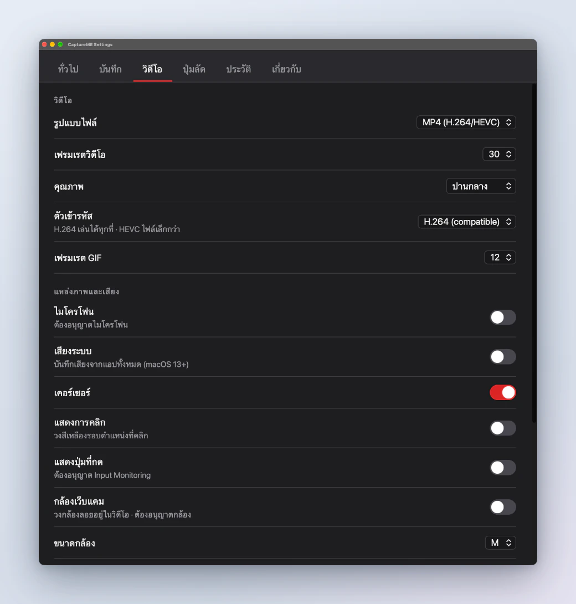 | **วิดีโอ** – รูปแบบ / เฟรมเรต / คุณภาพ / ตัวเข้ารหัส (H.264 · HEVC) · เสียงระบบ ไมค์ แสดงคลิก/ปุ่ม เว็บแคม · โฟลเดอร์เก็บวิดีโอ · จำกัดเวลา |
| 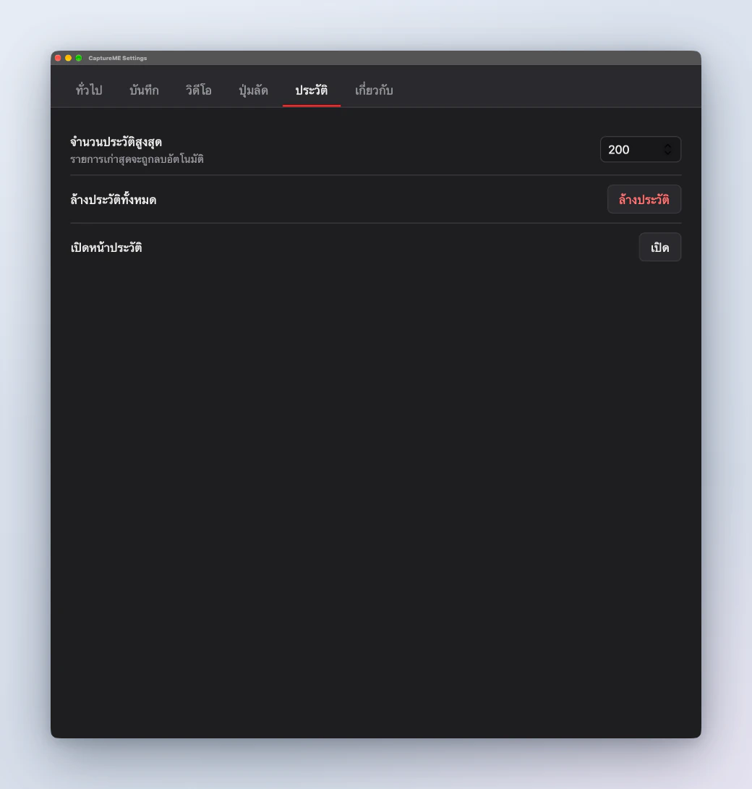 | **ประวัติ** – จำนวนสูงสุด · ล้างประวัติทั้งหมด · เปิดหน้าประวัติ |
| 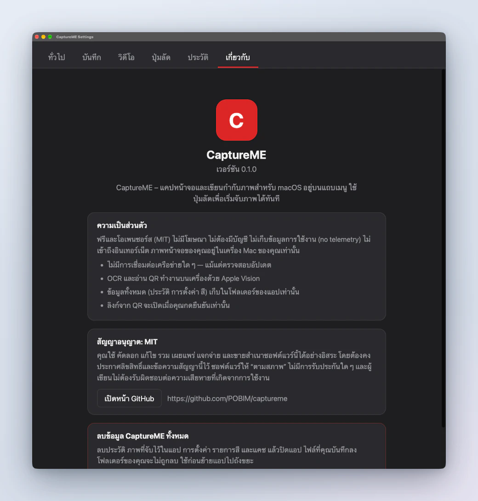 | **เกี่ยวกับ** – เวอร์ชัน · ข้อความความเป็นส่วนตัว · สัญญาอนุญาต MIT · ลิงก์ GitHub · **ลบข้อมูลทั้งหมด** |

---

## 12. ความเป็นส่วนตัว และการลบข้อมูล
- **ไม่ใช้อินเทอร์เน็ตเลย** ไม่มี telemetry ไม่มีบัญชี · ภาพ ประวัติ และการตั้งค่าอยู่ในเครื่องคุณเท่านั้น
- ลบภาพทีละรายการ/ทั้งหมดได้ที่ **ประวัติ** และ *ตั้งค่า › ประวัติ › ล้างประวัติทั้งหมด*
- ลบ **ข้อมูลทั้งหมดของ CaptureME** (ประวัติ ตั้งค่า สีที่เลือก ฯลฯ) ที่ *ตั้งค่า › เกี่ยวกับ › ลบข้อมูล CaptureME ทั้งหมด…* (ยืนยัน 2 ครั้ง) – รายละเอียดและวิธีถอนการติดตั้งที่ [PRIVACY.md](../PRIVACY.md)

---

## 13. คีย์ลัดทั้งหมด
### ทั่วระบบ (ปรับ/ปิดได้ใน ตั้งค่า › ปุ่มลัด)
| การทำงาน | คีย์ลัด |
|---|---|
| จับภาพเต็มหน้าจอ | `⌃⇧1` |
| จับภาพพื้นที่ | `⌃⇧2` |
| จับภาพหน้าต่าง | `⌃⇧3` |
| จับซ้ำพื้นที่เดิม | `⌃⇧4` |
| จับภาพหน่วงเวลา (5 วินาที) | `⌃⇧5` |
| สกรอลล์จับภาพ | `⌃⇧6` |
| บันทึกหน้าจอ / หยุด | `⌃⇧7` |
| OCR | `⌃⇧8` |
| ประวัติ | `⌃⇧9` |
| ปักหมุดพื้นที่ | `⌃⇧P` |
| ดูดสี | `⌃⇧C` |
| ไม้บรรทัดพิกเซล | `⌃⇧M` |
| อ่าน QR / บาร์โค้ด | `⌃⇧Q` |
| รูปจากคลิปบอร์ด → ตัวแก้ไข | `⌃⇧V` |

### ตัวแก้ไข
`⌘Z` เลิกทำ · `⇧⌘Z` ทำซ้ำ · `⌘C` คัดลอก · `⌘S` บันทึก · `⇧⌘S` บันทึกเป็น · `⌘↵` คัดลอกแล้วปิด · `⌘D` ทำสำเนา · `⌘A` เลือกทั้งหมด · `⌘G` จัดกลุ่ม · `⌘V` วางรูป · `⌘+`/`⌘-`/`⌘0`/`⌘1` ซูม · `⌘L`/`⌘R` หมุน · `Delete` ลบ · `Esc` ยกเลิก · `?` ช่วยเหลือ · เครื่องมือ: `V C A L R O P H T N Q Y U Z D B X S M E I` และ `1`–`9`

> ถ้าเจอปัญหา ดู [แก้ปัญหา](INSTALL-TH.md#แก้ปัญหา) หรือเปิด Issue ที่ https://github.com/POBIM/captureme/issues
